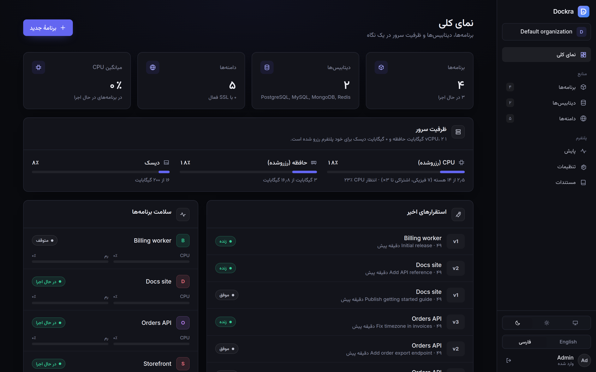
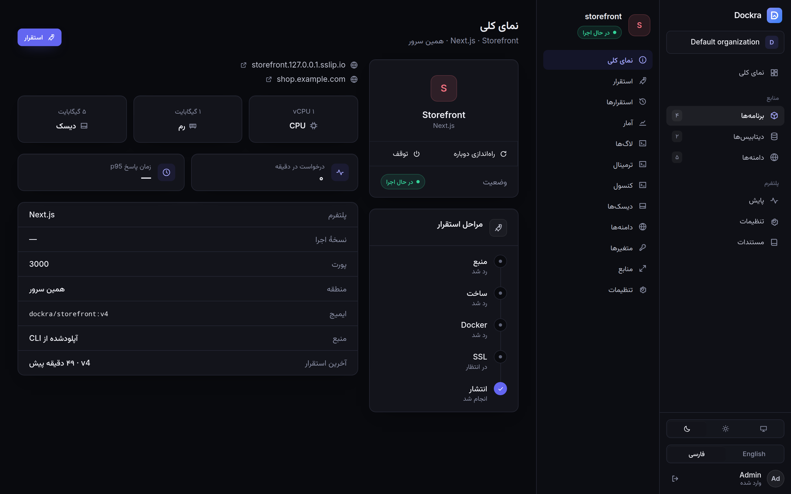
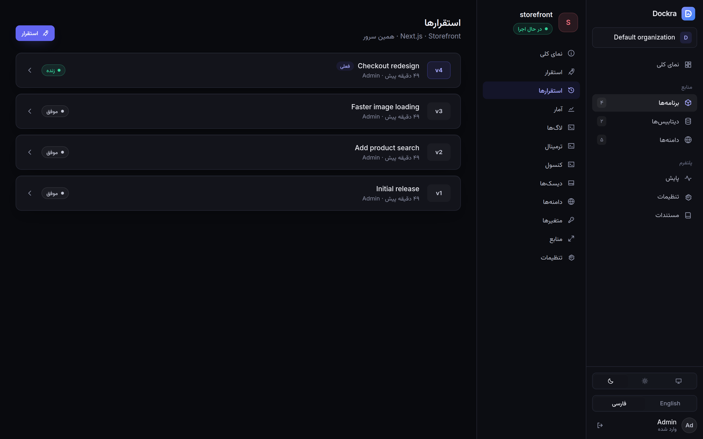
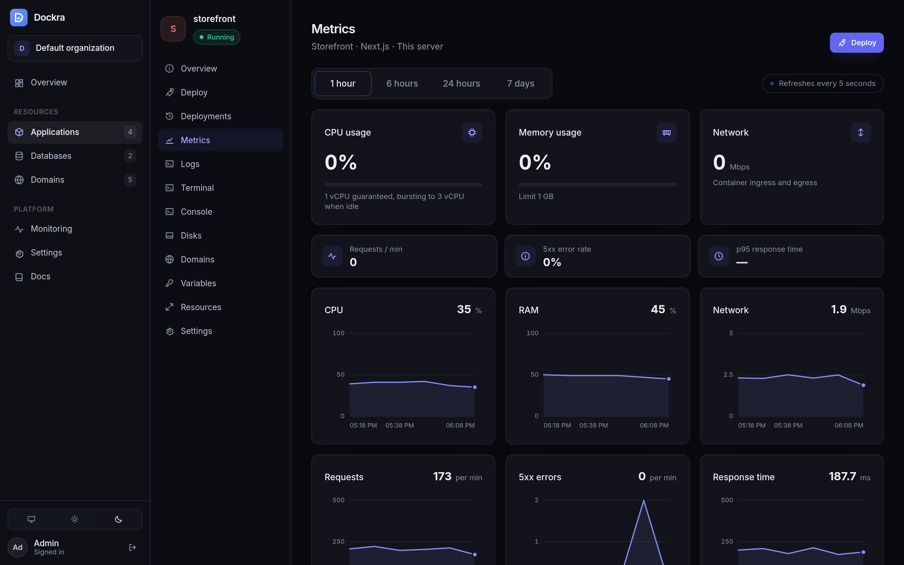
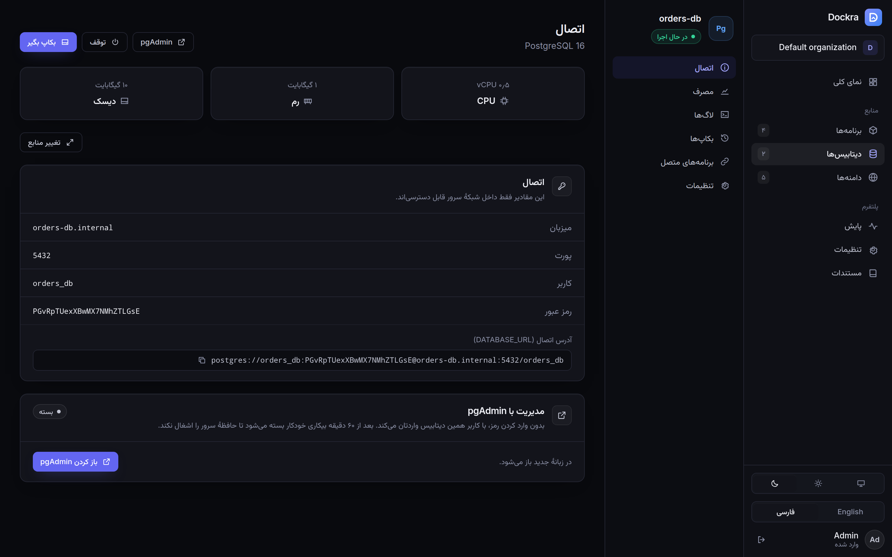
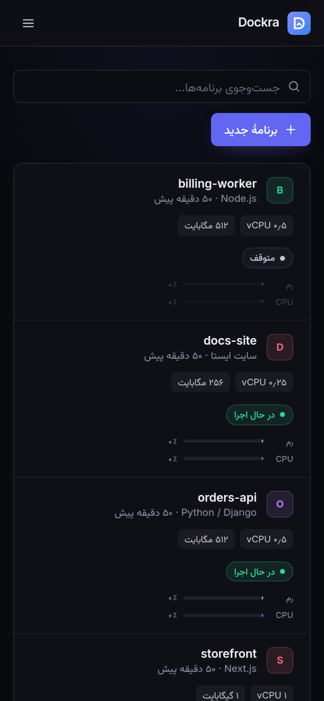
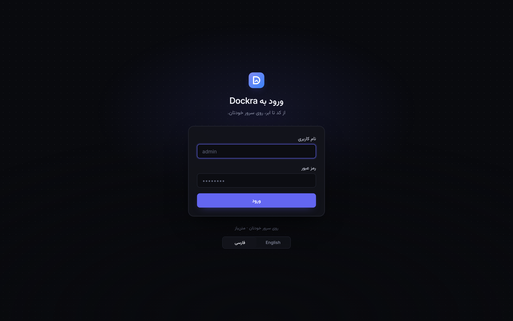
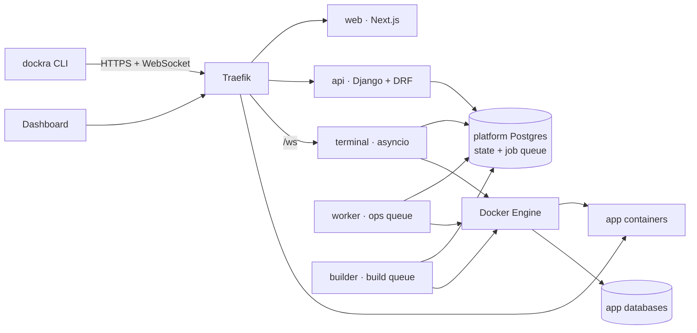
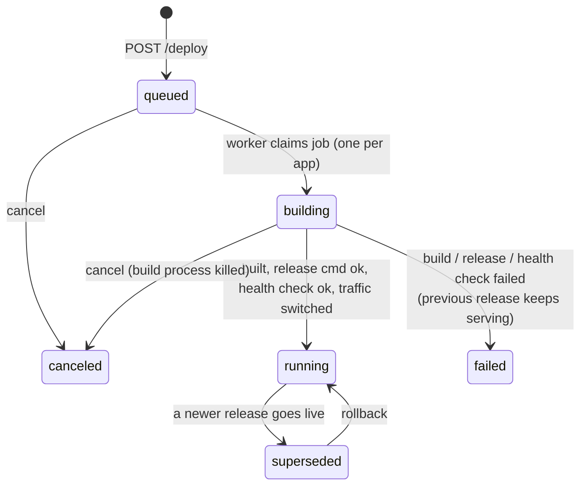

<p align="center"></p>

<h1 align="center">Dockra</h1>

<p align="center"><a href="README.md">English</a> · <b>فارسی</b></p>

<p align="center" dir="rtl"><b>از کد تا ابر.</b><br/>پلتفرم استقرار برنامه روی سرور خودتان: یک پوشه یا یک شاخهٔ Git بفرستید و برنامه‌ای در حال اجرا با دامنه، HTTPS، دیتابیس، بکاپ، لاگ و هشدار تحویل بگیرید؛ روی سروری که مال خودتان است.</p>

<p align="center" dir="rtl">
  <a href="#قابلیت‌ها">قابلیت‌ها</a> ·
  <a href="#تصاویر">تصاویر</a> ·
  <a href="#شروع-سریع">شروع سریع</a> ·
  <a href="#معماری">معماری</a> ·
  <a href="#مدل-امنیتی">امنیت</a> ·
  <a href="#محدودیت‌های-شناخته‌شده">محدودیت‌ها</a> ·
  <a href="docs/fa/README.md">مستندات</a>
</p>



```bash
dockra login
dockra deploy        # فقط فایل‌های تغییرکرده آپلود می‌شوند؛ انتشار بدون قطعی
```

Dockra یک PaaS تک‌سروری به سبک پلتفرم‌هایی مثل Heroku است، برای تیم‌هایی که می‌خواهند زیرساخت خودشان را اجرا کنند: یک لایهٔ کنترل با Django، داشبورد Next.js، یک CLI پایتونی بدون وابستگی و Docker به‌عنوان محیط اجرا. این یک پروژهٔ متن‌باز آموزشی است؛ کد برای خوانده شدن نوشته شده و [`docs/learn/`](docs/learn/README.md) تصمیم‌های طراحی را فصل به فصل توضیح می‌دهد.

## قابلیت‌ها

هر چیزی که این‌جا آمده پیاده‌سازی شده و تست‌ها یا اسکریپت end-to-end آن را پوشش می‌دهند؛ هیچ‌کدام ماکت نیست.

| بخش | چه می‌گیرید |
| --- | --- |
| **استقرار** | آپلود افزایشی (blobهای محتوامحور؛ فقط فایل‌های تغییرکرده فرستاده می‌شوند)، استقرار از Git با وب‌هوک امضاشده (GitHub، GitLab، Gitea)، قالب ساخت برای Django، Node.js، Next.js، سایت ایستا یا `Dockerfile` خودتان. فایل `liara.json` هم خوانده می‌شود. |
| **انتشار** | جابه‌جایی بدون قطعی: نسخهٔ جدید کنار نسخهٔ قبلی بالا می‌آید، سلامتش بررسی می‌شود و فقط بعد از آن جایگزین می‌شود. ساخت یا فرمان انتشار ناموفق به نسخهٔ فعلی دست نمی‌زند. بازگشت با یک کلیک به هر ایمیج قبلی، و لغو ساخت‌های در صف یا در حال اجرا. |
| **دیتابیس** | PostgreSQL، MySQL، MariaDB، MongoDB و Redis روی دیسک اختصاصی؛ بکاپ زمان‌بندی‌شده و دستی با سیاست نگهداری، بازگردانی با بکاپ احتیاطی خودکار، درون‌ریزی از فایل dump یا URL (تشخیص خودکار موتور و نسخه)، تونل TCP امن تا لپ‌تاپ شما، و رابط مدیریت وب با یک کلیک (pgAdmin، phpMyAdmin، Mongo Express، Redis Commander). |
| **دامنه و TLS** | دامنهٔ پیش‌فرض `<app>.<ip>.sslip.io` (یا دامنهٔ wildcard خودتان)، دامنهٔ اختصاصی با راهنمای رکورد DNS و بررسی زندهٔ رکورد، گواهی خودکار Let's Encrypt با Traefik، اجبار HTTPS، ریدایرکت مسیر و دامنه در لبه. |
| **ذخیره‌سازی** | دیسک ماندگار برای هر برنامه (فایل‌سیستم واقعی ext4 با سقف حجم)، مدیریت فایل، بکاپ زمان‌بندی‌شدهٔ دیسک، بازگردانی، درون‌ریزی از FTP/FTPS، لینک یا آرشیو. |
| **عملیات** | لاگ زنده و بایگانی‌شده با جست‌وجو، ترمینال تعاملی (`docker exec` روی WebSocket)، کنسول تک‌فرمانی، کران‌جاب، متغیرهای محیطی رمزنگاری‌شده، پلن منابع با burst پردازنده و کنترل پذیرش ظرفیت. |
| **پایش** | CPU، حافظه، شبکه، درخواست‌ها، نرخ 5xx و تأخیر p95 در هر دقیقه (از متریک‌های خود Traefik)؛ هشدار برای کرش پیاپی، مصرف بالا، برنامهٔ در دسترس‌نبودنی، فشار روی سرور و سرویس‌های ساکت پلتفرم، با ارسال به تلگرام یا هر وب‌هوکی. |
| **دسترسی** | سازمان با نقش‌های مالک، مدیر، توسعه‌دهنده و بیننده؛ ورود دومرحله‌ای TOTP، محدودیت تلاش ورود، توکن API با تاریخ انقضا، ورود CLI از مرورگر، گزارش فعالیت. |
| **زبان‌ها** | داشبورد، پیام‌های API و صفحه‌های ورود CLI انگلیسی و فارسی‌اند، با چیدمان کامل راست‌به‌چپ، ارقام فارسی و تقویم شمسی. زبان تا وقتی خودتان انتخاب نکنید از مرورگر گرفته می‌شود؛ اگر متنی ترجمه نداشته باشد CI می‌شکند. |
| **شبکه‌های محدود** | آینهٔ بسته‌ها و رجیستری، دریافت پیشاپیش ایمیج‌ها (`deploy/offline.sh`)، گواهی اختصاصی؛ پلتفرم بدون اینترنت عمومی هم کار می‌کند. |

## تصاویر

همهٔ تصاویر از برنامهٔ در حال اجرا گرفته شده‌اند (دادهٔ `seed_demo` و درایور fake) و با [`web/e2e/screenshots.cjs`](web/e2e/screenshots.cjs) دوباره ساخته می‌شوند.

<table>
<tr>
<td width="50%"></td>
<td width="50%"></td>
</tr>
<tr>
<td align="center"><b>نمای کلی برنامه</b><br/>دامنه‌ها، منابع، مراحل استقرار</td>
<td align="center"><b>تاریخچهٔ استقرار</b><br/>نسخه‌ها با لاگ ساخت، بازگشت و لغو</td>
</tr>
<tr>
<td></td>
<td></td>
</tr>
<tr>
<td align="center"><b>آمار</b><br/>CPU، حافظه، شبکه، درخواست، 5xx و تأخیر</td>
<td align="center"><b>دیتابیس</b><br/>اطلاعات اتصال، بکاپ‌ها، برنامه‌های متصل</td>
</tr>
</table>

<p align="center"> &nbsp; </p>

## فناوری‌ها

| لایه | فناوری |
| --- | --- |
| لایهٔ کنترل | Python 3.12، Django 5.2، Django REST Framework، SimpleJWT، PostgreSQL (SQLite برای توسعهٔ محلی) |
| workerها | همان کدبیس Django در حالت worker صف (`run_worker`)، جدول کار روی Postgres، قفل advisory |
| بلادرنگ | سرویس asyncio با `websockets` برای ترمینال، لاگ زنده و تونل دیتابیس |
| محیط اجرا | Docker Engine و BuildKit، Traefik 3 (مسیریابی، Let's Encrypt، متریک Prometheus) |
| داشبورد | Next.js 15 (App Router)، React 19، TypeScript، Tailwind CSS با توکن‌های طراحی روی متغیرهای CSS، xterm.js |
| CLI | یک فایل پایتون فقط با کتابخانهٔ استاندارد (`cli/dockra.py`)، قابل نصب از خود سرور |

## شروع سریع

### اجرای داشبورد روی سیستم خودتان (بدون Docker)

درایور `fake` کل API و خط کارها را بدون دست زدن به Docker اجرا می‌کند؛ برای کار روی رابط کاربری و آشنایی با محصول ایده‌آل است.

```bash
git clone <your fork> dockra && cd dockra
python3 -m venv .venv && . .venv/bin/activate
pip install -r api/requirements.txt

cd api
python manage.py migrate
python manage.py seed_demo                 # admin / dockra به‌همراه برنامه، دیتابیس و تاریخچهٔ نمونه
python manage.py runserver 127.0.0.1:8000
```

> `seed_demo` فقط دادهٔ نمایشی برای پنل می‌سازد. برنامه‌ها و دامنه‌های نمونه با درایور `fake` کانتینر واقعی ندارند، بنابراین لینک سایت‌های نمونه باز نمی‌شود. برای اجرای سایت واقعی، درایور `docker` را فعال کنید و برنامه را با CLI یا پنل deploy کنید.

در یک ترمینال دیگر:

```bash
cd web
npm ci
NEXT_PUBLIC_API_URL=http://127.0.0.1:8000 npm run dev     # http://127.0.0.1:3000
```

### نصب روی سرور

روی یک سرور لینوکس با Docker:

```bash
git clone <your fork> dockra && cd dockra/deploy
cp .env.example .env          # PUBLIC_IP و ACME_EMAIL را تنظیم کنید؛ رمزها خودکار ساخته می‌شوند
./install.sh
```

بعد روی هر سیستم توسعه، CLI را از سرور خودتان نصب کنید (بدون نیاز به PyPI یا npm):

```bash
curl -fsSL https://api.your-domain.example/cli/install.sh | sh
dockra login --api https://api.your-domain.example
```

راهنمای کامل: [نصب](docs/fa/installation.md) و [پیکربندی](docs/fa/configuration.md).

## معماری



API هیچ‌وقت با Docker صحبت نمی‌کند: درخواست را اعتبارسنجی می‌کند، وضعیت را می‌نویسد و یک `Job` در صف می‌گذارد. builderها، workerها و سرویس ترمینال کارها را از Postgres برمی‌دارند و Docker را با CLI آن هدایت می‌کنند. کارهای کوتاه درخواست/پاسخ (کنسول، لاگ کانتینر، آماده‌سازی دیسک) از صف `rpc` می‌گذرند که API منتظرش می‌ماند. به این ترتیب تنها پروسهٔ پایتونی که رو به اینترنت است به `docker.sock` دسترسی ندارد. جزئیات: [معماری](docs/fa/architecture.md).

## چرخهٔ استقرار



1. **آپلود:** CLI از همهٔ فایل‌ها هش می‌گیرد؛ سرور هش‌هایی را که ندارد برمی‌گرداند و فقط همان‌ها فرستاده می‌شوند.
2. **صف:** یک `Deployment` و یک `Job` ساخته می‌شود. کارهای مربوط به یک هدف هیچ‌وقت هم‌زمان اجرا نمی‌شوند.
3. **ساخت:** آینهٔ برنامه با درخت جدید همگام می‌شود، Dockerfile از قالب پلتفرم ساخته می‌شود و BuildKit با کش pip/npm می‌سازد.
4. **انتشار:** فرمان انتشار (مثلاً migrationها) یک بار در کانتینری موقت اجرا می‌شود. اگر شکست بخورد، همین‌جا متوقف می‌شود.
5. **جابه‌جایی:** نمونه‌های جدید کنار قبلی‌ها بالا می‌آیند، سلامتشان بررسی می‌شود و ترافیک را می‌گیرند؛ نمونه‌های قدیمی متوقف و لاگ‌هایشان بایگانی می‌شود.

ایمنی در برابر کرش: هر کار ضربان (heartbeat) دارد؛ کاری که worker آن مرده ناموفق علامت می‌خورد و برنامه‌اش آزاد می‌شود. توضیح کامل: [چرخهٔ استقرار](docs/fa/deployment-lifecycle.md).

## مدل امنیتی

Dockra کد **تیم شما** را روی سرور **شما** اجرا می‌کند. برنامه‌ها را از هم و از پلتفرم جدا می‌کند، ولی کانتینر Docker محیط امنی برای اجرای کد مهاجم نیست. نکات اصلی:

- API که رو به اینترنت است سوکت Docker ندارد؛ worker، builder و ترمینال دارند (معادل root روی سرور).
- هر برنامه شبکهٔ Docker خودش را دارد؛ برنامه‌ها به برنامه‌های دیگر، دیتابیس‌های وصل‌نشده یا سرویس‌های پلتفرم دسترسی ندارند.
- کانتینرها با سقف CPU، حافظه و PID، گزینهٔ `no-new-privileges` و در قالب‌های داخلی با کاربر غیر root اجرا می‌شوند.
- رازها (مقدار متغیرها، رمز دیتابیس، رمز وب‌هوک، کلید TOTP) با Fernet رمزنگاری‌شده ذخیره می‌شوند؛ متغیرها با `--env-file` پاس داده می‌شوند، نه در خط فرمان.
- دسترسی مبتنی بر نقش در هر سازمان، TOTP، محدودیت تلاش ورود، نشست‌های JWT قابل ابطال، توکن‌های API هش‌شده، وب‌هوک با بررسی HMAC، محافظ SSRF برای درخواست‌های سمت سرور و باز کردن امن آرشیو در برابر path traversal.

مدل تهدید کامل و فهرست صادقانهٔ چیزهایی که **محافظت نمی‌شوند** در [امنیت](docs/fa/security.md) آمده است.

## تست و اعتبارسنجی

| مجموعه | فرمان | چه چیزی را پوشش می‌دهد |
| --- | --- | --- |
| تست واحد و یکپارچگی API | `cd api && python manage.py test` | ۱۸۲ تست: چرخهٔ استقرار، لغو و بازگشت، بازیابی پس از ساخت ناموفق، برداشتن هم‌زمان کارها، بازیابی worker مرده، RBAC و جداسازی سازمان‌ها، رمزنگاری رازها، کنترل ظرفیت، قواعد دیسک، بکاپ و بازگردانی، درون‌ریزی، وب‌هوک، محافظ SSRF، ورود CLI، زبان پاسخ‌ها |
| Migrationها | `python manage.py makemigrations --check --dry-run` | هماهنگی مدل‌ها و migrationها |
| Lint | `ruff check api cli` | خطاهای پایتون و کد بی‌استفاده |
| داشبورد | `cd web && npx tsc --noEmit && npm run i18n:check && npx next build` | نوع‌ها، کامل بودن ترجمه و build نهایی |
| دود رابط کاربری | `node web/e2e/screenshots.cjs` | ورود و رندر همهٔ صفحه‌ها در هر دو پوسته؛ با هر خطای کنسول شکست می‌خورد |
| End to end | `deploy/e2e.sh` | Docker واقعی: نصب، استقرار، استقرار دوباره بدون قطعی، بازگشت، دیتابیس، بکاپ، شبکهٔ ایزوله |

CI موارد بالا را در هر push و اسکریپت end-to-end را روی Ubuntu اجرا می‌کند ([`.github/workflows/ci.yml`](.github/workflows/ci.yml)).

## بده‌بستان‌های فنی

- **Postgres به‌عنوان صف کار** به‌جای Redis یا RabbitMQ: یک سرویس کمتر برای اجرا و بکاپ، ثبت کار در همان تراکنش تغییر وضعیت، و `pg_advisory_xact_lock` برای برداشتن امن و هم‌زمان کارها. هزینه‌اش تأخیر polling (حدود ۱ ثانیه) و ظرفیت محدود است که برای یک سرور کافی است.
- **CLI داکر به‌جای SDK:** فرمان‌های دقیق در لاگ دیده می‌شوند و اپراتور می‌تواند تکرارشان کند؛ هزینه‌اش پارس کردن خروجی CLI است.
- **یک سرور، یک Docker:** بدون زمان‌بند، بدون شبکهٔ overlay، بدون وضعیت توزیع‌شده. اجرا و فهمیدنش ساده است؛ مقیاس افقی نمی‌گیرد (نقشهٔ راه را ببینید).
- **ایمیج‌های ext4 روی loop برای دیسک‌ها:** سقف حجم واقعی و بکاپ جدا برای هر دیسک، بدون LVM یا درایور ذخیره‌سازی؛ ساختنشان یک کمک‌کار با دسترسی ویژه لازم دارد.
- **CLI فقط با کتابخانهٔ استاندارد:** با `curl | sh` از سرور نصب می‌شود، حتی روی سیستمی که به pip دسترسی ندارد؛ هزینه‌اش کد HTTP و WebSocket دست‌نویس است.
- **ترجمه با دیکشنری JSON به‌جای gettext:** یک مدل ذهنی برای پنل و API، بدون ابزارهای GNU gettext و فایل‌های باینری `.mo`؛ هزینه‌اش نداشتن ابزارهای آماده برای مترجم‌هاست.

## محدودیت‌های شناخته‌شده

- فقط یک سرور: بدون خوشه و بدون جایگزینی خودکار؛ سرور نقطهٔ شکست واحد است.
- مرز ایزوله‌سازی Docker است؛ برای بارهای کاری چندمستأجرهٔ غیرقابل‌اعتماد **مناسب نیست** ([امنیت](docs/fa/security.md) را ببینید).
- ساخت‌ها روی Docker خود سرور اجرا می‌شوند؛ یک `Dockerfile` مخرب می‌تواند تا پایان مهلت منابع ساخت را مصرف کند.
- API فقط برای ورود محدودیت نرخ دارد؛ بقیهٔ endpointها به احراز هویت و reverse proxy تکیه می‌کنند.
- **داده‌های ذخیره‌شدهٔ** برنامه‌ها و دیتابیس‌ها (دیسک‌ها، فایل‌های بکاپ، نسخه‌های S3) را Dockra رمزنگاری نمی‌کند.
- نگهداری متریک فقط تا `DOCKRA_METRICS_DAYS` (پیش‌فرض ۷ روز) است و ارسال بلندمدت لاگ نداریم.
- لاگ ساخت و اعلان‌هایی که worker می‌فرستد همیشه انگلیسی‌اند (هنگام ساختشان زبان کاربری در کار نیست).

## نقشهٔ راه

- استقرار پیش‌نمایش برای هر pull request
- محدودیت نرخ برای همهٔ endpointهای تغییردهنده
- محیط‌های ایزوله‌سازی قابل تعویض (gVisor، Kata Containers) برای جداسازی قوی‌تر
- زمان‌بندی چندسروری با یک agent سبک روی هر سرور
- خروجی OpenTelemetry برای متریک و لاگ
- ورود یکپارچه با OIDC

## ساختار مخزن

| مسیر | محتوا |
| --- | --- |
| `api/` | پروژهٔ Django: REST API، اجراکنندهٔ کارها، درایور Docker، سرویس ترمینال |
| `web/` | داشبورد Next.js |
| `cli/` | فرمان `dockra` (یک فایل، فقط کتابخانهٔ استاندارد) |
| `deploy/` | استک docker-compose، نصب‌کننده، به‌روزرسان، تست end-to-end، ابزار ایمیج آفلاین |
| `docs/` | مستندات ([انگلیسی](docs/README.md)، [فارسی](docs/fa/README.md)) و [راهنمای یادگیری](docs/learn/README.md) |

## مشارکت

از مشارکت استقبال می‌کنیم؛ [CONTRIBUTING.md](CONTRIBUTING.md) را ببینید. لطفاً آسیب‌پذیری‌ها را طبق [SECURITY.md](SECURITY.md) به‌صورت خصوصی گزارش کنید.

## مجوز

[MIT](LICENSE)
