<p align="center"></p>

<h1 align="center">Dockra</h1>

<p align="center"><b>English</b> · <a href="README.fa.md">فارسی</a></p>

<p align="center"><b>From code to cloud.</b><br/>A self-hosted application deployment platform: push a folder or a Git branch, get a running app with a domain, HTTPS, databases, backups, logs and alerts — on a server you own.</p>

<p align="center">
  <a href="#features">Features</a> ·
  <a href="#screenshots">Screenshots</a> ·
  <a href="#quick-start">Quick start</a> ·
  <a href="#architecture">Architecture</a> ·
  <a href="#security-model">Security</a> ·
  <a href="#known-limitations">Limitations</a> ·
  <a href="docs/README.md">Docs</a>
</p>

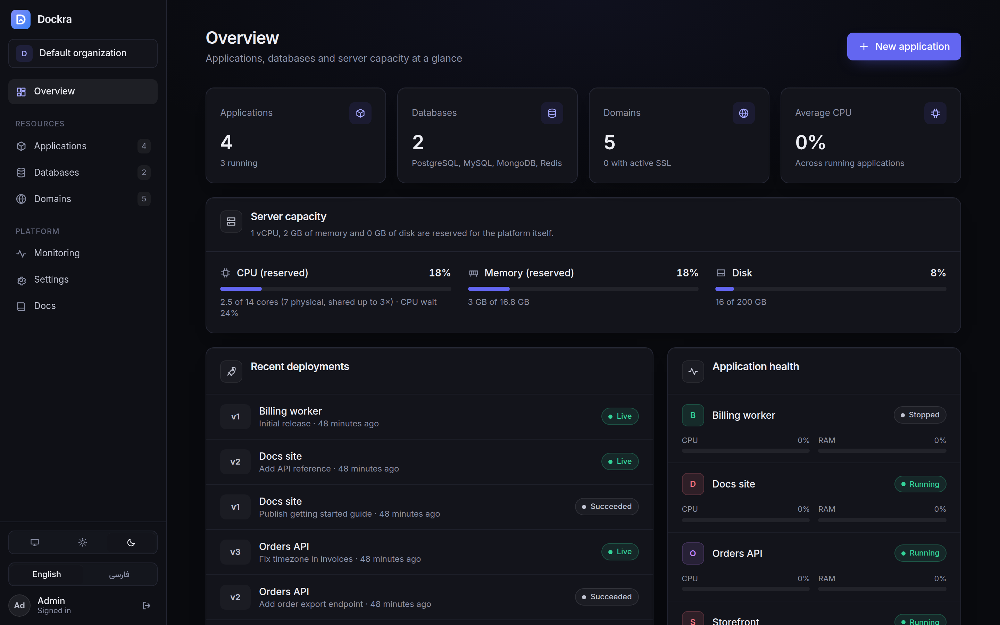

```bash
dockra login
dockra deploy        # only changed files are uploaded; zero-downtime release
```

Dockra is a single-server PaaS in the spirit of Heroku-style platforms, built for teams that want to run their own infrastructure: a Django control plane, a Next.js dashboard, a dependency-free Python CLI and Docker as the runtime. It is an educational open-source project — the code is written to be read, and [`docs/learn/`](docs/learn/README.md) walks through the design decisions chapter by chapter.

## Features

Everything listed here is implemented and covered by the test suite or the end-to-end script; nothing is a mock-up.

| Area | What you get |
| --- | --- |
| **Deploy** | Incremental uploads (content-addressed blobs, only changed files are sent), Git deploys via signed webhooks (GitHub, GitLab, Gitea), build templates for Django, Node.js, Next.js, static sites, or your own `Dockerfile`. `liara.json` manifests are read too. |
| **Releases** | Zero-downtime switch: the new release starts beside the old one, is health-checked, and only then replaces it. A failed build or release command leaves the current version untouched. One-click rollback to any previous image, cancel for queued or running builds. |
| **Databases** | PostgreSQL, MySQL, MariaDB, MongoDB and Redis on dedicated disks; scheduled and manual backups with retention, restore with an automatic safety backup, import from a dump file or URL (engine and version auto-detected), secure TCP tunnel to your laptop, one-click web admin (pgAdmin, phpMyAdmin, Mongo Express, Redis Commander). |
| **Domains & TLS** | Default `<app>.<ip>.sslip.io` (or your wildcard domain), custom domains with DNS record guidance and a live record check, automatic Let's Encrypt certificates via Traefik, force-HTTPS, path and domain redirects answered at the edge. |
| **Storage** | Persistent disks per app (real ext4 filesystems with a hard size), file manager, scheduled disk backups, restore, import over FTP/FTPS, URL or archive. |
| **Operations** | Live and archived logs with search, an interactive terminal (`docker exec` over WebSocket), a one-shot console, cron jobs, env vars encrypted at rest, resource plans with CPU burst and capacity admission control. |
| **Observability** | Per-minute CPU, memory, network, requests, 5xx rate and p95 latency (from Traefik's own metrics); alerts for crash loops, high usage, unreachable apps, host pressure and silent platform services, delivered to Telegram or any webhook. |
| **Access** | Organizations with owner / admin / developer / viewer roles, TOTP two-factor auth, login throttling, expiring API tokens, browser-based CLI login, audit log. |
| **Languages** | The dashboard, the API messages and the CLI sign-in pages speak English and Persian, with a full right-to-left layout, Persian digits and the Solar Hijri calendar. The language follows the browser until you pick one; a CI check fails when a string has no translation. |
| **Restricted networks** | Package and registry mirrors, image pre-pulling (`deploy/offline.sh`), bring-your-own certificates — the platform keeps working without public internet. |

## Screenshots

All images come from the running app (`seed_demo` data, fake driver) and are regenerated with [`web/e2e/screenshots.cjs`](web/e2e/screenshots.cjs).

<table>
<tr>
<td width="50%">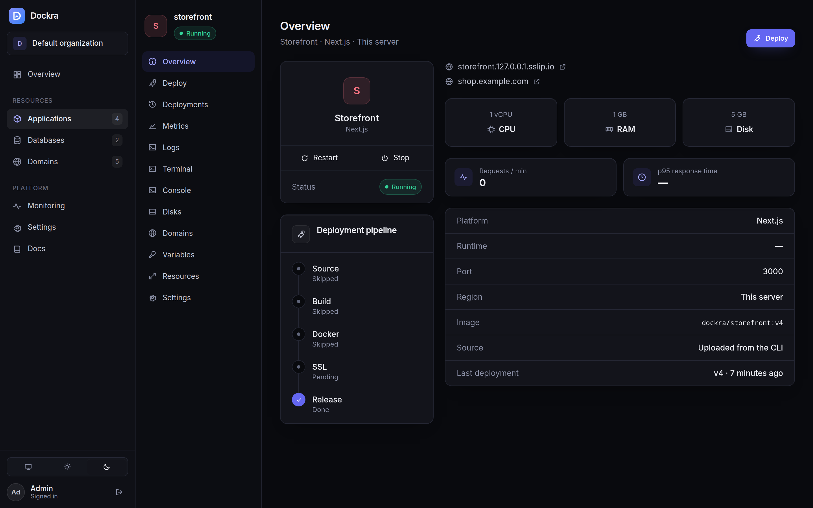</td>
<td width="50%">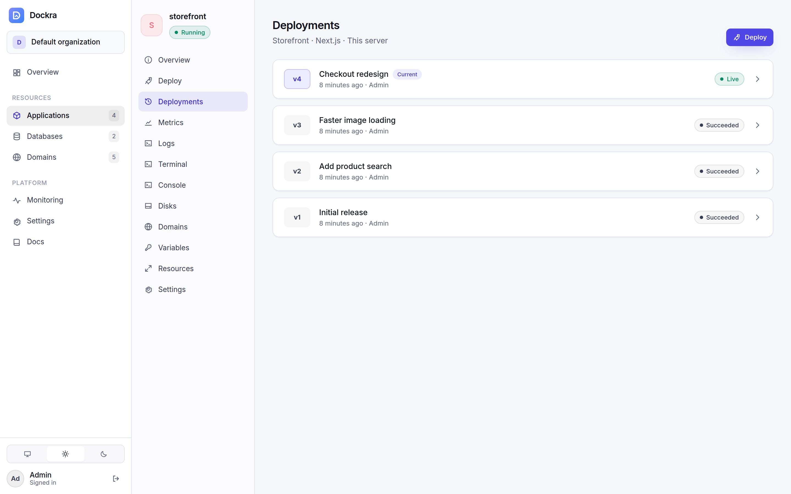</td>
</tr>
<tr>
<td align="center"><b>Application overview</b><br/>Domains, resources, deployment pipeline</td>
<td align="center"><b>Deployment history (light)</b><br/>Releases with build logs, rollback and cancel</td>
</tr>
<tr>
<td>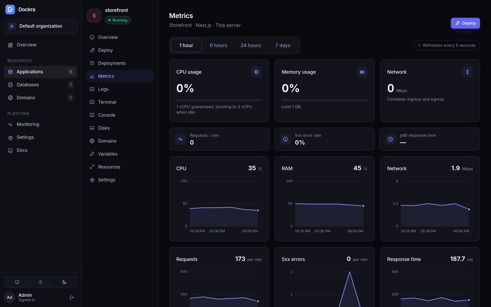</td>
<td>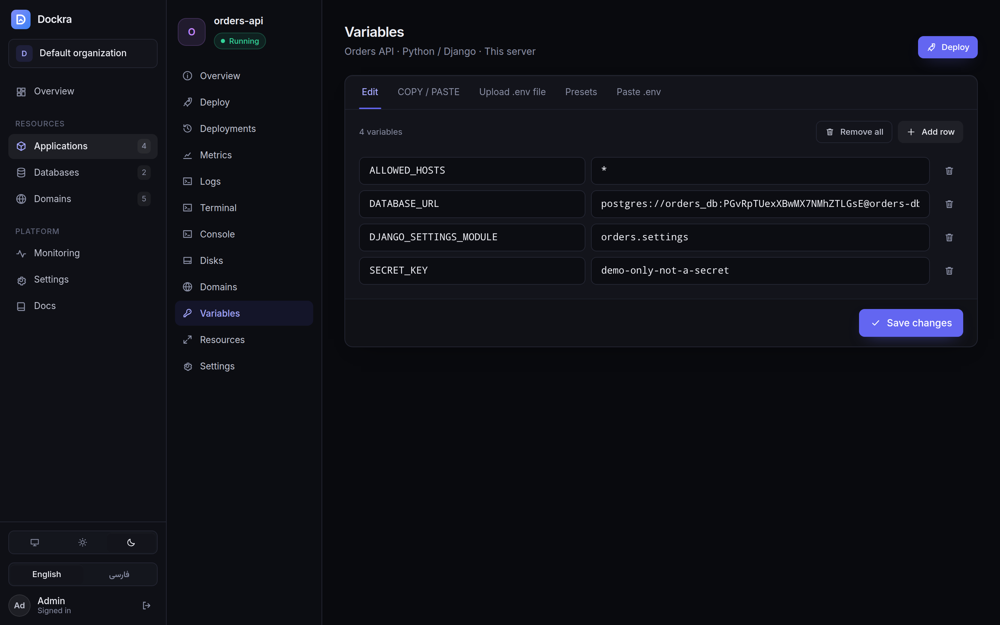</td>
</tr>
<tr>
<td align="center"><b>Metrics</b><br/>CPU, memory, network, requests, 5xx and latency</td>
<td align="center"><b>Environment variables</b><br/>Encrypted at rest, masked for viewers</td>
</tr>
<tr>
<td>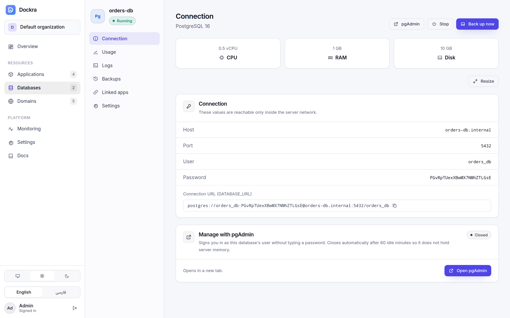</td>
<td>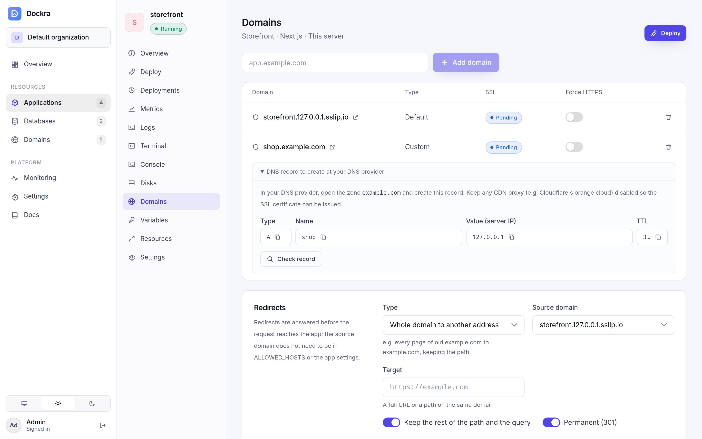</td>
</tr>
<tr>
<td align="center"><b>Database</b><br/>Connection details, backups, linked apps</td>
<td align="center"><b>Domains & SSL</b><br/>Custom domains, DNS check, force HTTPS</td>
</tr>
<tr>
<td>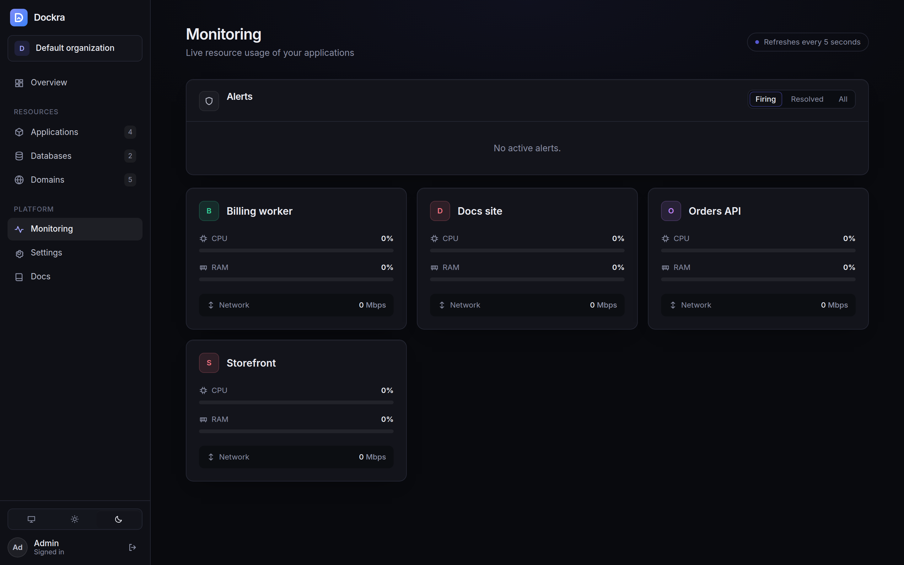</td>
<td>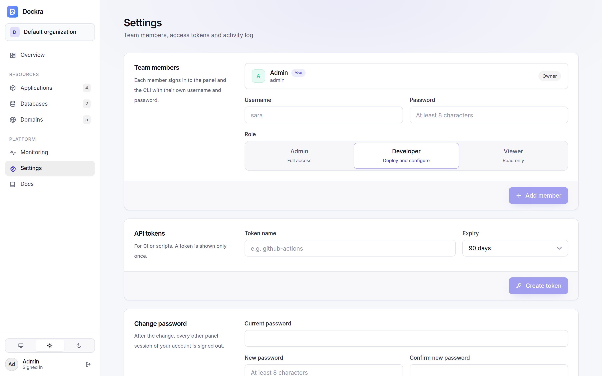</td>
</tr>
<tr>
<td align="center"><b>Monitoring & alerts</b></td>
<td align="center"><b>Team, tokens and audit log</b></td>
</tr>
</table>

<p align="center">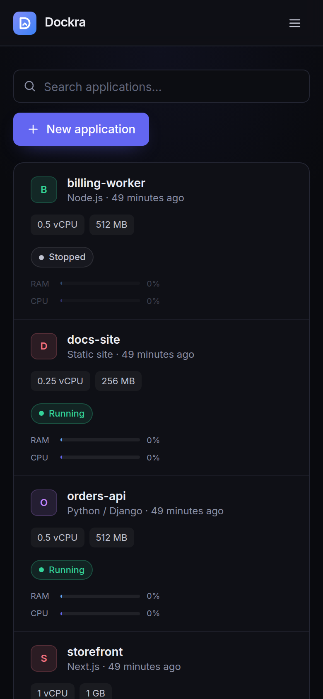 &nbsp; 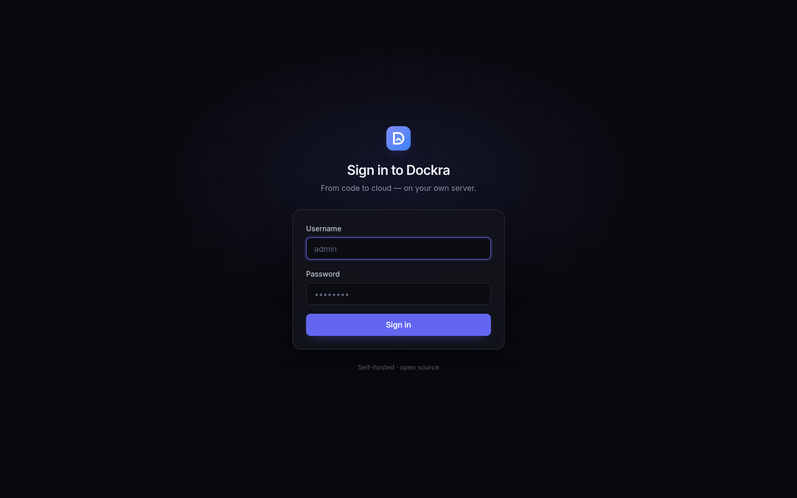</p>

## Tech stack

| Layer | Technology |
| --- | --- |
| Control plane | Python 3.12, Django 5.2, Django REST Framework, SimpleJWT, PostgreSQL (SQLite for local dev) |
| Workers | The same Django codebase in queue-worker mode (`run_worker`), a Postgres-backed job table, advisory locks |
| Realtime | An asyncio `websockets` service for the terminal, live logs and database tunnels |
| Runtime | Docker Engine + BuildKit, Traefik 3 (routing, Let's Encrypt, Prometheus metrics) |
| Dashboard | Next.js 15 (App Router), React 19, TypeScript, Tailwind CSS with CSS-variable design tokens, xterm.js |
| CLI | A single Python file using only the standard library (`cli/dockra.py`), installable from the server itself |

## Quick start

### Run the dashboard locally (no Docker needed)

The `fake` driver executes the full API and job pipeline without touching Docker, which makes it ideal for UI work and for exploring the product.

```bash
git clone <your fork> dockra && cd dockra
python3 -m venv .venv && . .venv/bin/activate
pip install -r api/requirements.txt

cd api
python manage.py migrate
python manage.py seed_demo                 # admin / dockra + sample apps, databases and history
python manage.py runserver 127.0.0.1:8000
```

In a second terminal:

```bash
cd web
npm ci
NEXT_PUBLIC_API_URL=http://127.0.0.1:8000 npm run dev     # http://127.0.0.1:3000
```

### Install on a server

On a Linux host with Docker:

```bash
git clone <your fork> dockra && cd dockra/deploy
cp .env.example .env          # set PUBLIC_IP and ACME_EMAIL; secrets are generated
./install.sh
```

Then, on any developer machine, install the CLI from your server (no PyPI or npm needed):

```bash
curl -fsSL https://api.your-domain.example/cli/install.sh | sh
dockra login --api https://api.your-domain.example
```

See [installation](docs/installation.md) and [configuration](docs/configuration.md).

## Architecture

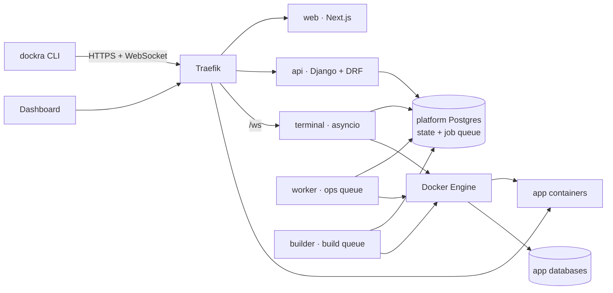

The API never talks to Docker: it validates the request, writes state, and enqueues a `Job`. Builders, workers and the terminal service claim jobs from Postgres and drive Docker through its CLI. Short request/response operations (console, container logs, disk preparation) go through an `rpc` queue the API waits on. This keeps the only internet-facing Python process free of `docker.sock`. Details: [architecture](docs/architecture.md).

## Deployment lifecycle

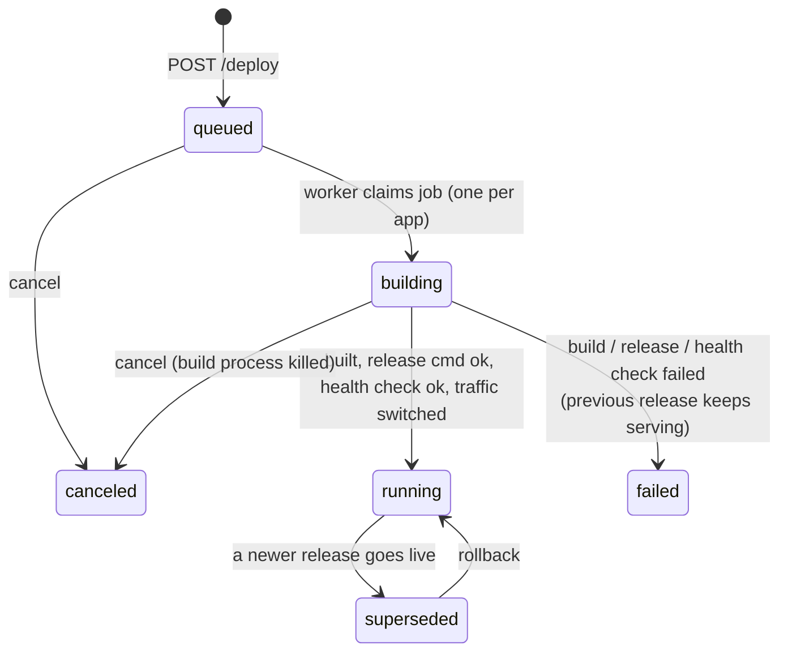

1. **Upload** — the CLI hashes every file; the server answers with the hashes it is missing; only those are sent.
2. **Queue** — a `Deployment` and a `Job` are created. Jobs on the same target never run concurrently.
3. **Build** — the app's mirror is synced with the new tree, a Dockerfile is generated from the platform template, and BuildKit builds with pip/npm caches.
4. **Release** — the release command (e.g. migrations) runs once in a one-off container. Failure stops here.
5. **Switch** — new instances start next to the old ones, are health-checked, and receive traffic; the old ones are stopped and their logs archived.

Crash-safety: jobs carry a heartbeat; a job whose worker died is marked failed and its app unblocked. Full description: [deployment lifecycle](docs/deployment-lifecycle.md).

## Security model

Dockra runs **your team's** code on **your** server. It isolates apps from each other and from the platform, but Docker containers are not a sandbox for hostile code. Highlights:

- The internet-facing API has no Docker socket; worker, builder and terminal do (root-equivalent on the host).
- Each app has its own Docker network; apps cannot reach other apps, unlinked databases or platform services.
- Containers run with CPU, memory and PID limits, `no-new-privileges`, and non-root users in the built-in templates.
- Secrets (env values, database passwords, webhook secrets, TOTP keys) are encrypted at rest with Fernet; env vars are passed with `--env-file`, never on the command line.
- Role-based access per organization, TOTP, login throttling, revocable JWT sessions, hashed API tokens, HMAC-verified webhooks, SSRF guards on server-side fetches, path-traversal-safe archive extraction.

Read [security](docs/security.md) for the full threat model and the honest list of what is **not** protected.

## Tests and validation

| Suite | Command | What it covers |
| --- | --- | --- |
| API unit and integration | `cd api && python manage.py test` | 182 tests: deployment lifecycle, cancel and rollback, failed-build recovery, concurrent job claiming, stale-worker recovery, RBAC and tenant isolation, secrets at rest, capacity admission, disk rules, backups and restore, imports, webhooks, SSRF guards, CLI login flow, response language |
| Migrations | `python manage.py makemigrations --check --dry-run` | models and migrations are in sync |
| Lint | `ruff check api cli` | Python errors and unused code |
| Dashboard | `cd web && npx tsc --noEmit && npm run i18n:check && npx next build` | type safety, translation coverage and production build |
| UI smoke | `node web/e2e/screenshots.cjs` | signs in and renders every screen in both themes, fails on console errors |
| End to end | `deploy/e2e.sh` | real Docker: install, deploy, zero-downtime redeploy, rollback, database, backup, isolated network |

CI runs the first four on every push and the end-to-end script on Ubuntu runners ([`.github/workflows/ci.yml`](.github/workflows/ci.yml)).

## Technical trade-offs

- **Postgres as the job queue** instead of Redis/RabbitMQ: one fewer service to run and back up, transactional enqueueing with the state change, `pg_advisory_xact_lock` for safe concurrent claiming. The cost is polling latency (~1 s) and limited throughput — fine for a single server.
- **Docker CLI instead of the SDK**: the exact commands are visible in logs and reproducible by an operator; the cost is parsing CLI output.
- **One server, one Docker daemon**: no scheduler, no overlay network, no distributed state. Simple to operate and reason about; it does not scale out (see roadmap).
- **Loop-mounted ext4 images for disks**: real, enforced size limits and per-disk backups without LVM or a storage driver; creating them needs a privileged helper.
- **A standard-library CLI**: installs from the server with `curl | sh` on machines without pip access; the cost is hand-written HTTP and WebSocket code.

## Known limitations

- Single host only: no clustering, no automatic failover; the host is a single point of failure.
- Docker is the isolation boundary; it is **not** suitable for untrusted multi-tenant workloads (see [security](docs/security.md)).
- Builds run on the host's Docker daemon; a malicious `Dockerfile` can consume build resources until the timeout.
- The API rate-limits sign-in only; other endpoints rely on authentication and the reverse proxy.
- App and database **data at rest** (disks, backup files, S3 copies) are not encrypted by Dockra.
- No built-in metrics retention beyond `DOCKRA_METRICS_DAYS` (7 days by default) and no long-term log shipping.

## Roadmap

- Preview deployments per pull request
- Rate limiting for all mutating endpoints
- Pluggable isolation runtimes (gVisor, Kata Containers) for stronger sandboxing
- Multi-node scheduling with a lightweight agent per host
- OpenTelemetry export for metrics and logs
- OIDC single sign-on

## Repository layout

| Path | Contents |
| --- | --- |
| `api/` | Django project: REST API, job runner, Docker driver, terminal service |
| `web/` | Next.js dashboard |
| `cli/` | `dockra` command (single file, standard library only) |
| `deploy/` | docker-compose stack, installer, updater, end-to-end test, offline image tools |
| `docs/` | Documentation and the [learning guide](docs/learn/README.md) |

## Contributing

Contributions are welcome — see [CONTRIBUTING.md](CONTRIBUTING.md). Please report vulnerabilities privately as described in [SECURITY.md](SECURITY.md).

## License

[MIT](LICENSE)
