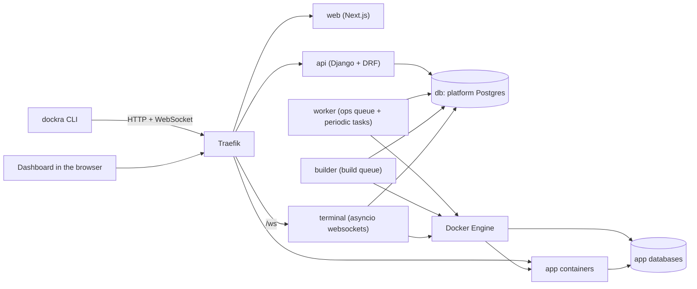

# Architecture

**English** · [فارسی](fa/architecture.md)

Dockra is a single-host platform made of one Python codebase run in several roles, a Next.js dashboard, a CLI, Traefik and Docker.

## Components

| Service | Role | Docker socket |
| --- | --- | :-: |
| **api** | REST API for the dashboard and CLI; writes state and enqueues jobs. Short operations that need Docker (console, container logs, disk preparation) are sent to the `rpc` queue and awaited with `run_rpc`. Reads disk files directly through `rslave` bind mounts. | no |
| **worker** | `run_worker --queues ops`: start/stop, databases, backups, sync, removals, cron, periodic maintenance (metrics, alerts, automatic backups, stale job recovery, cleanup). | yes |
| **builder** | `run_worker --queues build`: deployments and rollbacks. Scale with `DOCKRA_BUILDERS`. | yes |
| **terminal** | `run_terminal`: interactive terminal, live logs and database tunnels over WebSocket, plus four threads serving the `rpc` queue, so long connections never occupy Gunicorn threads. | yes |
| **web** | The Next.js dashboard. Talks only to the API. | no |
| **traefik** | Routing, TLS (Let's Encrypt or your certificates), redirects, Prometheus metrics on an internal entrypoint. | read-only |
| **db** | The platform's own Postgres: state, job queue, metrics, audit log. | no |

api, worker, builder and terminal share one image (`dockra-api`). They drive Docker through its CLI (`docker run`, `docker build`, …), not the SDK, so every action an operator sees in a log can be reproduced by hand.

**Heartbeats.** worker, builder and terminal write a `ServiceBeat` every 15 seconds; worker and terminal watch each other. A service silent for 90 seconds raises a `service` alert and makes `/api/health` return 503. A clean shutdown (SIGTERM) deletes the row, so scaling builders down raises nothing.

**Drivers.** `engine/drivers.py` has `DockerDriver` for servers and `FakeDriver` for local development and tests. `DOCKRA_DRIVER` selects one. With the fake driver, `DOCKRA_EAGER=1` runs jobs inline in the request, so the whole product works on a laptop without Docker.

## Code layout

| Path | Responsibility |
| --- | --- |
| `api/config/` | settings, URL routing, field encryption (`crypto.py`) |
| `api/accounts/` | sign-in, 2FA, tokens, members and roles, CLI browser login (`cli_web.py`), CLI distribution (`cli_dist.py`) |
| `api/apps_core/views.py` | apps, deployments, env, domains, disks, cron, dashboard |
| `api/apps_core/extra.py` | incremental upload, live and archived logs, console, webhooks, disk files, alerts, terminal tickets |
| `api/apps_core/validation.py` | shared disk and redirect validation for the API and manifests |
| `api/databases/` | databases, backups, restore, import, links, web admin |
| `api/engine/` | driver, job runner, blobs, build templates, volumes, capacity, metrics, alerts, notifications, logs, terminal, S3 |
| `web/` | Next.js dashboard; `lib/api.ts` is the API client, `components/ui.tsx` the design-system primitives |
| `cli/dockra.py` | the whole CLI in one file, standard library only |
| `deploy/` | compose files, `install.sh`, `update.sh`, `e2e.sh`, `offline.sh` |

## Data model

| Django app | Models |
| --- | --- |
| `accounts` | `Organization`, `Membership` (role), `ApiToken` (sha256 hash, expiry), `TwoFactor`, `LoginAttempt`, `SessionVersion` (the `sv` JWT claim; bumped on logout, password change, deactivation), `CliLogin`, `CliWatch` |
| `apps_core` | `App`, `Deployment` (number, status, build log, image, tree hash), `EnvVar` (encrypted), `Domain`, `Redirect`, `Disk`, `DiskBackup`, `CronJob` |
| `databases` | `Database` (encrypted password), `DatabaseLink`, `Backup` (kind, path, S3 key) |
| `engine` | `Job`, `MetricSample`, `Alert`, `ServiceBeat` |
| `audit` | `AuditLog` |

Sensitive fields use `config.crypto.EncryptedTextField` (Fernet, `enc:` prefix).

## Job queue (`engine/runner.py`)

- **Queues.** `Job.queue` is `build` (deploy, rollback), `ops` (everything that changes state) or `rpc` (exec, logs, volume; the result is stored in `Job.result` and cleared once read).
- **Per-target serialization.** `Job.target` is `app:<slug>` or `db:<id>`. `_claim` picks the oldest queued job whose target has no running job and claims it with a conditional `UPDATE … WHERE status='queued'`, so two workers can never claim the same row. On Postgres the selection runs under `pg_advisory_xact_lock`. `rpc` jobs have no target so they never wait behind a long build of the same app.
- **Heartbeat and recovery.** While a job runs, a thread refreshes `heartbeat_at` every 15 seconds. `recover_stale_jobs` marks jobs silent for `DOCKRA_JOB_STALE_SECONDS` as failed and releases their app or database; it is idempotent.
- **Container lock.** Everything that swaps containers of an app runs under `app_lock` (a Postgres advisory lock), so a build and a settings sync of the same app never remove each other's containers.
- **Cron.** `CronRunner` runs due cron jobs every minute in a thread pool and never overlaps runs of the same entry.

## Networks

| Network | Members |
| --- | --- |
| `dockra` | platform services and all app databases (for tunnels and backups) |
| `dockra-app-<slug>` | the app's instances and release container, Traefik, the worker or builder that started it, and databases linked to the app (aliased by container name) |
| `dockra-dbadmin-<name>` | a database admin UI, Traefik and that one database |

`_ensure_app_network` creates the network and its attachments before every start (deploy, rollback, sync, release). `connect_database` reattaches a database to its apps after it is (re)created. `reconnect_routes` reattaches a recreated Traefik to every app network every 30 seconds.

## Incremental upload (`engine/blobs.py`)

Each file is stored once under `blobs/<2 chars>/<sha256>`; the server re-hashes on receipt. A deployment's file list (the *tree*) is itself a blob referenced by `Deployment.tree`. `missing()` refreshes the mtime of existing blobs so garbage collection cannot remove them between `sync` and `deploy`. Hourly GC removes blobs older than a day that are not referenced by the last `DOCKRA_BLOB_KEEP_DEPLOYS` deployments of any app or by queued ones.

Each app has a **mirror** (`work/mirror/<slug>/`) of its latest tree. The build folder of a deployment is a hardlink copy of the mirror; generated files (`Dockerfile`, `dockra-start.sh`, …) are unlinked before being written so the mirror is never modified.

## Disks (`engine/volumes.py`)

Every disk (app or database) is an image file created with `fallocate` and `mkfs.ext4`, loop-mounted under `mnt/<name>` and recorded in `/etc/fstab`; `mnt/<name>/data` is bind-mounted into the container. This gives hard per-disk size limits without LVM. Creating and mounting runs **in the host's namespaces**: a short-lived privileged container from the `dockra-api` image runs `nsenter -t 1 -a`. Grow-only resizing is done online.

## Terminal and tunnels (`engine/terminal.py`)

The API issues a signed ticket (`django.core.signing`, 60 seconds) naming the kind, the user and the target. The terminal service accepts a ticket once, re-checks role and organization, then:

- **logs** — `docker logs -f` for every instance, streamed as binary frames;
- **terminal** — `docker exec -it` under a pty (`setsid`, `TIOCSCTTY`), resize with `TIOCSWINSZ`;
- **tunnel** — a TCP connection to the database on the `dockra` network, bytes relayed both ways.

## Database admin UIs (`engine/dbadmin.py`, `databases/console.py`)

1. The dashboard calls `POST /api/databases/<id>/admin`; `admin_until` is set and a `db_admin` job is queued.
2. The worker starts `dockra-dbadmin-<name>` on its own network with only Traefik and the database.
3. Traefik routes `Host(<api host>) && PathPrefix(/dbadmin/<name>/)` through a `forwardAuth` middleware to the API.
4. The dashboard opens `/api/dbadmin/open?t=<60 s ticket>`, which sets an HttpOnly signed cookie scoped to `/dbadmin/<name>/` and redirects.
5. `forwardAuth` checks the user, session version and role (at least developer) for every request (30-second in-memory cache) and extends `admin_until` at most once a minute. Idle tools are closed by maintenance.

## Observability

- `engine/traffic.py` reads Traefik's Prometheus counters every minute, turns cumulative counters into per-minute deltas (detecting Traefik restarts), and estimates mean and p95 latency from histogram buckets.
- `engine/metrics.py` takes one `docker stats` snapshot for all containers plus request stats and stores a `MetricSample`; charts are downsampled to at most 240 points. The dashboard never runs `docker stats` in a request.
- `engine/alerts.py` evaluates alert rules; `Alert` rows move between `firing` and `resolved` and notify once on each transition.
- `engine/notify.py` delivers to Telegram (or any Telegram-compatible API) and a generic webhook in a background thread.
- `engine/logs.py` archives the logs of removed containers (gzip) and searches them.

## Dashboard (`web/`)

- Next.js App Router; every page is a client component that talks to the API with a bearer token stored in `localStorage` (the CSP prevents loading external scripts or exfiltrating to other origins).
- `lib/api.ts` wraps `fetch` with error normalization, an in-memory cache for instant back-navigation, and chunked resumable uploads.
- `components/ui.tsx` holds the primitives; colors come only from the design tokens described in [design-system.md](design-system.md).
- `lib/i18n.ts` and `lib/locales/fa/` translate the panel (English text as key, Persian dictionary); every request sends `Accept-Language`, and Django's `LocaleMiddleware` plus `config/i18n.py` answer API messages in the same language. See [development.md](development.md#translations-english-and-persian).
