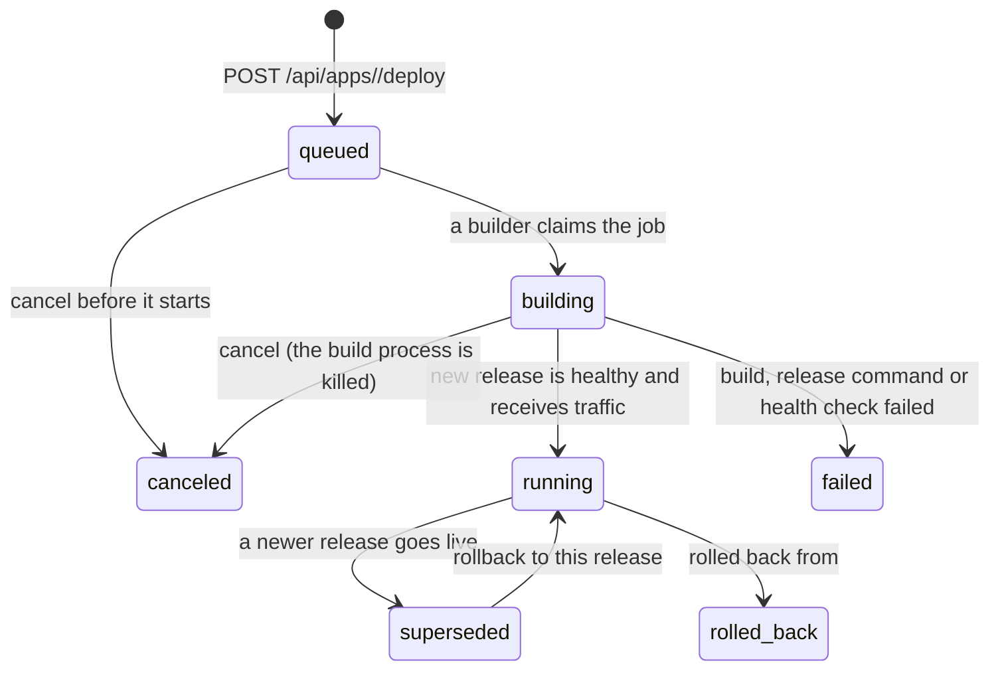
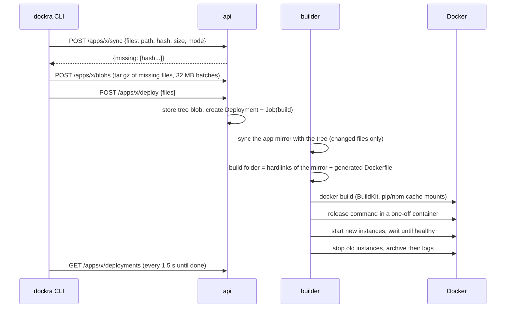

# Deployment lifecycle

This document follows one deployment from `dockra deploy` to live traffic, and explains what happens when something fails along the way.

## States

`Deployment.status` values: `queued`, `building`, `running` (the live release), `superseded`, `failed`, `rolled_back`, `canceled`. `App.status` is `deploying` while a deployment is in flight, and goes back to `running` (or `failed` when there is no previous release to fall back to).

## Step by step

1. **Upload.** The CLI applies ignore rules (`.dockraignore`, `.liaraignore`, `.dockerignore`, `.gitignore`), hashes files (with a local cache keyed by size and mtime) and asks which hashes the server lacks. Only those are uploaded. `--full` falls back to a tar.gz of the folder. Git deploys (webhook or `git_url`) clone instead.
2. **Queue.** The API checks capacity (CPU, memory, disk reservations with overcommit factors and real host memory) and creates the `Deployment` and `Job` in one request. A deploy that does not fit is rejected with 400 before anything is queued.
3. **Claim.** A builder claims the oldest job whose target has no running job. Two deploys of the same app are therefore strictly sequential; deploys of different apps run in parallel up to the number of builders.
4. **Build.** The platform template (`engine/source.py`) generates a Dockerfile for Django, Node.js, Next.js or static sites, or uses the project's own. Base images are pulled through configured mirrors if needed. The build runs with `DOCKRA_BUILD_TIMEOUT` and is checked for cancel requests every few seconds.
5. **Release command.** If the manifest has `release` (e.g. `python manage.py migrate --noinput`), it runs once with the app's env and disks, in a one-off container, before any traffic reaches the new image. Failure aborts the deployment: *the current release keeps serving*.
6. **Switch (zero downtime).** Under the app lock, new instances `dockra-app-<slug>-<release>-<n>` start with the same Traefik service name, so Traefik load-balances across old and new immediately. `_wait_ready` checks the container state, the image `HEALTHCHECK`, and a direct TCP or HTTP probe (`healthCheck.path`) within `DOCKRA_HEALTH_TIMEOUT`. On success, the previous instances are stopped (`docker stop -t 10`), their logs archived, and they are removed. On failure, the *new* instances are removed and the error is raised with their logs.
7. **Finish.** The deployment becomes `running`, the previous one `superseded`, an audit entry and a notification are written.

## Failure handling

| What fails | Result |
| --- | --- |
| Capacity check | 400 at request time; nothing queued |
| Upload interrupted | `sync` is repeatable; uploaded blobs are kept; chunked uploads resume from the last offset |
| Build error or timeout | deployment `failed`, build log kept, live release untouched |
| Release command fails | deployment `failed`, image built but never started, live release untouched |
| New release unhealthy | new containers removed, deployment `failed`, live release untouched |
| User cancels while queued | job and deployment end immediately (`canceled`); no worker picks it up |
| User cancels while building | `cancel_requested` is set; the build watcher kills the process; deployment `canceled` |
| Builder process dies | heartbeat stops; after `DOCKRA_JOB_STALE_SECONDS` the job and deployment are marked failed and the app is released for a retry |

There is no automatic retry of failed deployments: a deploy is a user intent and a build that failed once (a syntax error, a bad migration) usually fails again. Retrying is one click or command. Backups, by contrast, are retried automatically after `DOCKRA_BACKUP_RETRY_MINUTES`.

## Rollback

`POST /api/apps/<slug>/rollback {deployment_id}` queues a `rollback` job that starts the stored image of that deployment through the same zero-downtime switch. The release command is **not** re-run, so database migrations are not reverted; design migrations to be backward compatible.

## Settings changes

Changing env vars, domains, disks, redirects or resources queues a `sync` job that recreates containers through the same switch, so configuration changes are also zero-downtime. If the container cannot be updated, the API reports that the value was saved but not applied (502).

## Idempotency notes

- Claiming a job is a conditional update: a job runs at most once.
- `recover_stale_jobs`, automatic backups and alert evaluation can run repeatedly without duplicating work.
- Uploads are content-addressed: re-sending the same blob is a no-op; a chunk sent twice is rejected with 409 and the current size, so the client resumes correctly.
