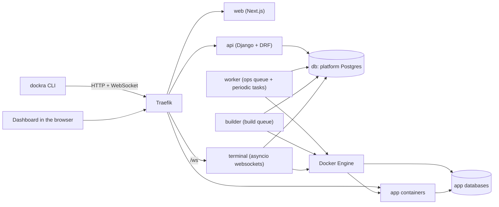

# معماری

[English](../architecture.md) · **فارسی**

Dockra پلتفرمی تک‌سروری است که از این‌ها ساخته شده: یک کدبیس پایتون که در چند نقش اجرا می‌شود، یک داشبورد Next.js، یک CLI، Traefik و Docker.

## اجزا

| سرویس | نقش | سوکت Docker |
| --- | --- | :-: |
| **api** | REST API برای داشبورد و CLI؛ وضعیت را می‌نویسد و کار در صف می‌گذارد. کارهای کوتاهی که Docker لازم دارند (کنسول، لاگ کانتینر، آماده‌سازی دیسک) به صف `rpc` فرستاده می‌شوند و با `run_rpc` منتظر جوابشان می‌ماند. فایل‌های دیسک را مستقیم از bind mountهای `rslave` می‌خواند. | ندارد |
| **worker** | `run_worker --queues ops`: روشن و خاموش کردن، دیتابیس‌ها، بکاپ، همگام‌سازی، حذف، کران، نگهداری دوره‌ای (متریک، هشدار، بکاپ خودکار، بازیابی کارهای گیرکرده، پاک‌سازی). | دارد |
| **builder** | `run_worker --queues build`: استقرار و بازگشت نسخه. تعدادش با `DOCKRA_BUILDERS` تنظیم می‌شود. | دارد |
| **terminal** | `run_terminal`: ترمینال تعاملی، لاگ زنده و تونل دیتابیس روی WebSocket، به‌علاوهٔ چهار thread که صف `rpc` را سرویس می‌دهند؛ پس اتصال‌های طولانی هیچ‌وقت threadهای Gunicorn را اشغال نمی‌کنند. | دارد |
| **web** | داشبورد Next.js. فقط با API صحبت می‌کند. | ندارد |
| **traefik** | مسیریابی، TLS (Let's Encrypt یا گواهی‌های خودتان)، ریدایرکت، متریک Prometheus روی یک ورودی داخلی. | فقط خواندن |
| **db** | Postgres خود پلتفرم: وضعیت، صف کار، متریک، گزارش فعالیت. | ندارد |

api، worker، builder و terminal یک ایمیج مشترک دارند (`dockra-api`). Docker را از طریق CLI آن (`docker run`، `docker build` و…) هدایت می‌کنند، نه SDK؛ پس هر کاری که اپراتور در لاگ می‌بیند با دست قابل تکرار است.

**ضربان.** worker، builder و terminal هر ۱۵ ثانیه یک `ServiceBeat` می‌نویسند و worker و terminal همدیگر را می‌پایند. سرویسی که ۹۰ ثانیه ساکت بماند هشدار `service` می‌سازد و `/api/health` را به 503 می‌برد. خاموش شدن عادی (SIGTERM) ردیف را پاک می‌کند، پس کم کردن تعداد builderها هشداری نمی‌سازد.

**درایورها.** `engine/drivers.py` دو درایور دارد: `DockerDriver` برای سرور و `FakeDriver` برای توسعهٔ محلی و تست. `DOCKRA_DRIVER` یکی را انتخاب می‌کند. با درایور fake، `DOCKRA_EAGER=1` کارها را همان‌جا داخل درخواست اجرا می‌کند؛ پس کل محصول روی لپ‌تاپ بدون Docker کار می‌کند.

## چیدمان کد

| مسیر | مسئولیت |
| --- | --- |
| `api/config/` | تنظیمات، مسیریابی URL، رمزنگاری فیلدها (`crypto.py`)، ترجمهٔ پیام‌ها (`i18n.py`، `locale/`) |
| `api/accounts/` | ورود، 2FA، توکن‌ها، اعضا و نقش‌ها، ورود مرورگری CLI (`cli_web.py`)، توزیع CLI (`cli_dist.py`) |
| `api/apps_core/views.py` | برنامه‌ها، استقرارها، متغیرها، دامنه‌ها، دیسک‌ها، کران، داشبورد |
| `api/apps_core/extra.py` | آپلود افزایشی، لاگ زنده و بایگانی، کنسول، وب‌هوک، فایل‌های دیسک، هشدارها، بلیت ترمینال |
| `api/apps_core/validation.py` | اعتبارسنجی مشترک دیسک و ریدایرکت برای API و مانیفست |
| `api/databases/` | دیتابیس‌ها، بکاپ، بازگردانی، درون‌ریزی، اتصال به برنامه، رابط مدیریت وب |
| `api/engine/` | درایور، اجراکنندهٔ کارها، blobها، قالب‌های ساخت، والیوم‌ها، ظرفیت، متریک، هشدار، اعلان، لاگ، ترمینال، S3 |
| `web/` | داشبورد Next.js؛ `lib/api.ts` کلاینت API و `components/ui.tsx` اجزای پایهٔ سیستم طراحی |
| `cli/dockra.py` | کل CLI در یک فایل، فقط با کتابخانهٔ استاندارد |
| `deploy/` | فایل‌های compose، `install.sh`، `update.sh`، `e2e.sh`، `offline.sh` |

## مدل داده

| اپ Django | مدل‌ها |
| --- | --- |
| `accounts` | `Organization`، `Membership` (نقش)، `ApiToken` (هش sha256، انقضا)، `TwoFactor`، `LoginAttempt`، `SessionVersion` (ادعای `sv` در JWT؛ با خروج، تغییر رمز و غیرفعال شدن یکی زیاد می‌شود)، `CliLogin`، `CliWatch` |
| `apps_core` | `App`، `Deployment` (شماره، وضعیت، لاگ ساخت، ایمیج، هش درخت)، `EnvVar` (رمزنگاری‌شده)، `Domain`، `Redirect`، `Disk`، `DiskBackup`، `CronJob` |
| `databases` | `Database` (رمز رمزنگاری‌شده)، `DatabaseLink`، `Backup` (نوع، مسیر، کلید S3) |
| `engine` | `Job`، `MetricSample`، `Alert`، `ServiceBeat` |
| `audit` | `AuditLog` |

فیلدهای حساس از `config.crypto.EncryptedTextField` استفاده می‌کنند (Fernet با پیشوند `enc:`).

## صف کار (`engine/runner.py`)

- **صف‌ها.** `Job.queue` یکی از این‌هاست: `build` (استقرار، بازگشت)، `ops` (هر چیزی که وضعیت را تغییر می‌دهد) یا `rpc` (exec، لاگ، والیوم؛ نتیجه در `Job.result` ذخیره و بعد از خوانده شدن پاک می‌شود).
- **سریال‌سازی برای هر هدف.** `Job.target` به شکل `app:<slug>` یا `db:<id>` است. `_claim` قدیمی‌ترین کار در صفی را برمی‌دارد که هدفش کار در حال اجرا ندارد و آن را با یک `UPDATE … WHERE status='queued'` شرطی ادعا می‌کند؛ پس دو worker هیچ‌وقت یک ردیف را با هم برنمی‌دارند. روی Postgres انتخاب زیر `pg_advisory_xact_lock` انجام می‌شود. کارهای `rpc` هدف ندارند تا پشت یک ساخت طولانی از همان برنامه منتظر نمانند.
- **ضربان و بازیابی.** تا وقتی کاری اجرا می‌شود، یک thread هر ۱۵ ثانیه `heartbeat_at` را تازه می‌کند. `recover_stale_jobs` کارهایی را که `DOCKRA_JOB_STALE_SECONDS` ساکت بوده‌اند ناموفق علامت می‌زند و برنامه یا دیتابیسشان را آزاد می‌کند؛ این تابع idempotent است.
- **قفل کانتینر.** هر کاری که کانتینرهای یک برنامه را جابه‌جا می‌کند زیر `app_lock` (یک قفل advisory در Postgres) اجرا می‌شود؛ پس یک ساخت و یک همگام‌سازی تنظیمات از همان برنامه کانتینرهای همدیگر را پاک نمی‌کنند.
- **کران.** `CronRunner` هر دقیقه کران‌جاب‌های موعدرسیده را در یک thread pool اجرا می‌کند و هیچ‌وقت اجراهای یک مورد را روی هم نمی‌اندازد.

## شبکه‌ها

| شبکه | اعضا |
| --- | --- |
| `dockra` | سرویس‌های پلتفرم و همهٔ دیتابیس‌های برنامه‌ها (برای تونل و بکاپ) |
| `dockra-app-<slug>` | نمونه‌های برنامه و کانتینر انتشار، Traefik، worker یا builderی که آن را روشن کرده، و دیتابیس‌های متصل به برنامه (با نام مستعار برابر نام کانتینر) |
| `dockra-dbadmin-<name>` | رابط مدیریت یک دیتابیس، Traefik و فقط همان دیتابیس |

`_ensure_app_network` پیش از هر روشن شدن (استقرار، بازگشت، همگام‌سازی، انتشار) شبکه و اتصال‌هایش را می‌سازد. `connect_database` بعد از (باز)ساخته شدن دیتابیس آن را دوباره به برنامه‌هایش وصل می‌کند. `reconnect_routes` هر ۳۰ ثانیه Traefik بازساخته‌شده را به همهٔ شبکه‌های برنامه‌ها وصل می‌کند.

## آپلود افزایشی (`engine/blobs.py`)

هر فایل یک بار با مسیر `blobs/<2 chars>/<sha256>` ذخیره می‌شود و سرور هنگام دریافت دوباره هش می‌گیرد. فهرست فایل‌های یک استقرار (*درخت*) خودش یک blob است که `Deployment.tree` به آن اشاره می‌کند. `missing()` زمان تغییر blobهای موجود را تازه می‌کند تا جمع‌آوری زباله بین `sync` و `deploy` آن‌ها را پاک نکند. GC ساعتی blobهایی را پاک می‌کند که بیش از یک روز عمر دارند و هیچ‌کدام از `DOCKRA_BLOB_KEEP_DEPLOYS` استقرار آخر برنامه‌ها یا استقرارهای در صف به آن‌ها ارجاع نمی‌دهند.

هر برنامه یک **آینه** (`work/mirror/<slug>/`) از آخرین درختش دارد. پوشهٔ ساخت هر استقرار کپی hardlink از آینه است؛ فایل‌های تولیدی (`Dockerfile`، `dockra-start.sh` و…) پیش از نوشته شدن unlink می‌شوند تا آینه هیچ‌وقت تغییر نکند.

## دیسک‌ها (`engine/volumes.py`)

هر دیسک (برنامه یا دیتابیس) یک فایل ایمیج است که با `fallocate` و `mkfs.ext4` ساخته، زیر `mnt/<name>` با loop مونت و در `/etc/fstab` ثبت می‌شود؛ `mnt/<name>/data` با bind mount داخل کانتینر قرار می‌گیرد. این روش بدون LVM برای هر دیسک سقف حجم واقعی می‌دهد. ساخت و مونت **در namespaceهای خود سرور** انجام می‌شود: یک کانتینر موقت با دسترسی ویژه از ایمیج `dockra-api` فرمان `nsenter -t 1 -a` را اجرا می‌کند. تغییر حجم فقط رو به بزرگ‌تر و به‌صورت آنلاین است.

## ترمینال و تونل‌ها (`engine/terminal.py`)

API یک بلیت امضاشده (`django.core.signing`، ۶۰ ثانیه) صادر می‌کند که نوع، کاربر و هدف را مشخص می‌کند. سرویس ترمینال هر بلیت را فقط یک بار می‌پذیرد، نقش و سازمان را دوباره بررسی می‌کند و بعد:

- **logs:** `docker logs -f` برای همهٔ نمونه‌ها، به‌صورت frameهای باینری؛
- **terminal:** `docker exec -it` زیر یک pty (`setsid`، `TIOCSCTTY`)، تغییر اندازه با `TIOCSWINSZ`؛
- **tunnel:** یک اتصال TCP به دیتابیس روی شبکهٔ `dockra` و رد و بدل کردن بایت‌ها در هر دو جهت.

## رابط‌های مدیریت دیتابیس (`engine/dbadmin.py`، `databases/console.py`)

1. داشبورد `POST /api/databases/<id>/admin` را صدا می‌زند؛ `admin_until` تنظیم و یک کار `db_admin` در صف گذاشته می‌شود.
2. worker کانتینر `dockra-dbadmin-<name>` را روی شبکهٔ جداگانه‌ای بالا می‌آورد که فقط Traefik و همان دیتابیس در آن هستند.
3. Traefik مسیر `Host(<api host>) && PathPrefix(/dbadmin/<name>/)` را از یک middleware از نوع `forwardAuth` به API می‌فرستد.
4. داشبورد `/api/dbadmin/open?t=<ticket 60 s>` را باز می‌کند که یک کوکی امضاشدهٔ HttpOnly محدود به `/dbadmin/<name>/` می‌گذارد و ریدایرکت می‌کند.
5. `forwardAuth` در هر درخواست کاربر، نسخهٔ نشست و نقش (حداقل توسعه‌دهنده) را بررسی می‌کند (با کش ۳۰ ثانیه‌ای در حافظه) و `admin_until` را حداکثر دقیقه‌ای یک بار تمدید می‌کند. ابزارهای بیکار را کار نگهداری می‌بندد.

## پایش

- `engine/traffic.py` هر دقیقه شمارنده‌های Prometheus خود Traefik را می‌خواند، شمارنده‌های تجمعی را به اختلاف دقیقه‌ای تبدیل می‌کند (با تشخیص ری‌استارت Traefik) و میانگین و p95 تأخیر را از سطل‌های هیستوگرام تخمین می‌زند.
- `engine/metrics.py` یک عکس‌فوری `docker stats` از همهٔ کانتینرها به‌همراه آمار درخواست‌ها می‌گیرد و یک `MetricSample` ذخیره می‌کند؛ نمودارها حداکثر ۲۴۰ نقطه دارند. داشبورد هیچ‌وقت در یک درخواست `docker stats` اجرا نمی‌کند.
- `engine/alerts.py` قواعد هشدار را ارزیابی می‌کند؛ ردیف‌های `Alert` بین `firing` و `resolved` جابه‌جا می‌شوند و در هر جابه‌جایی یک بار اعلان می‌دهند.
- `engine/notify.py` در یک thread پس‌زمینه به تلگرام (یا هر API سازگار با آن) و یک وب‌هوک عمومی می‌فرستد.
- `engine/logs.py` لاگ کانتینرهای حذف‌شده را بایگانی (gzip) و در آن‌ها جست‌وجو می‌کند.

## داشبورد (`web/`)

- Next.js App Router؛ هر صفحه یک کامپوننت سمت کلاینت است که با یک bearer token ذخیره‌شده در `localStorage` با API صحبت می‌کند (CSP جلوی بارگذاری اسکریپت خارجی یا ارسال داده به مبدأهای دیگر را می‌گیرد).
- `lib/api.ts` روی `fetch` یکسان‌سازی خطا، کش در حافظه برای برگشت فوری به صفحهٔ قبل و آپلود تکه‌تکهٔ قابل ادامه را اضافه می‌کند.
- `components/ui.tsx` اجزای پایه را دارد؛ رنگ‌ها فقط از توکن‌های طراحی [design-system.md](design-system.md) می‌آیند.
- `lib/i18n.ts` و `lib/locales/fa/` پنل را ترجمه می‌کنند (متن انگلیسی به‌عنوان کلید، دیکشنری فارسی)؛ هر درخواست `Accept-Language` می‌فرستد و `LocaleMiddleware` جنگو به‌همراه `config/i18n.py` پیام‌های API را به همان زبان برمی‌گردانند. [development.md](development.md#ترجمه-انگلیسی-و-فارسی) را ببینید.
