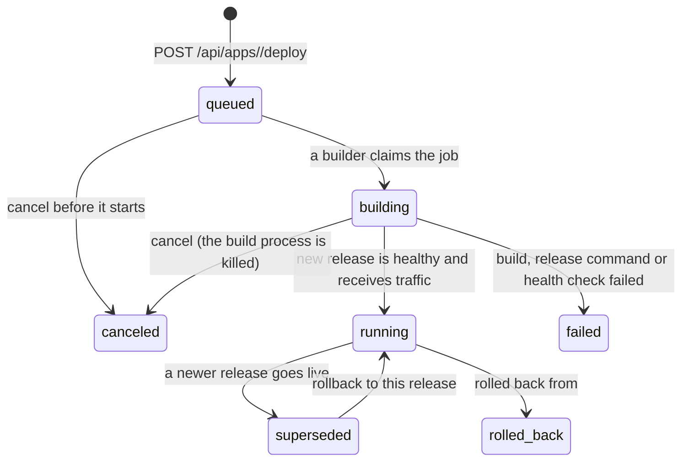
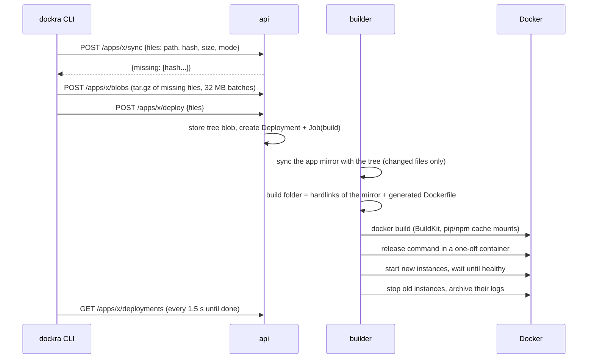

# چرخهٔ استقرار

[English](../deployment-lifecycle.md) · **فارسی**

این سند یک استقرار را از `dockra deploy` تا رسیدن ترافیک دنبال می‌کند و توضیح می‌دهد اگر وسط راه چیزی خراب شود چه اتفاقی می‌افتد.

## وضعیت‌ها

مقادیر `Deployment.status`: `queued`، `building`، `running` (نسخهٔ فعال)، `superseded`، `failed`، `rolled_back`، `canceled`. تا وقتی استقراری در جریان است `App.status` برابر `deploying` است و بعد به `running` برمی‌گردد (یا اگر نسخهٔ قبلی برای برگشت نباشد `failed` می‌شود).

## قدم به قدم

1. **آپلود.** CLI قواعد نادیده‌گیری (`.dockraignore`، `.liaraignore`، `.dockerignore`، `.gitignore`) را اعمال می‌کند، از فایل‌ها هش می‌گیرد (با کش محلی بر اساس اندازه و زمان تغییر) و می‌پرسد سرور کدام هش‌ها را ندارد. فقط همان‌ها آپلود می‌شوند. `--full` به ارسال tar.gz کل پوشه برمی‌گردد. استقرار از Git (وب‌هوک یا `git_url`) به‌جای این کار clone می‌کند.
2. **صف.** API ظرفیت را بررسی می‌کند (رزرو CPU، حافظه و دیسک با ضریب‌های overcommit و حافظهٔ واقعی سرور) و `Deployment` و `Job` را در یک درخواست می‌سازد. استقراری که جا نشود پیش از هر چیز با 400 رد می‌شود.
3. **برداشتن کار.** یک builder قدیمی‌ترین کاری را برمی‌دارد که هدفش کار در حال اجرا ندارد. پس دو استقرار از یک برنامه کاملاً پشت سر هم اجرا می‌شوند؛ استقرار برنامه‌های مختلف تا تعداد builderها موازی است.
4. **ساخت.** قالب پلتفرم (`engine/source.py`) برای Django، Node.js، Next.js یا سایت ایستا Dockerfile می‌سازد، یا از Dockerfile خود پروژه استفاده می‌کند. ایمیج‌های پایه در صورت نیاز از آینه‌های تنظیم‌شده دریافت می‌شوند. ساخت با مهلت `DOCKRA_BUILD_TIMEOUT` اجرا می‌شود و هر چند ثانیه درخواست لغو بررسی می‌شود.
5. **فرمان انتشار.** اگر مانیفست `release` داشته باشد (مثلاً `python manage.py migrate --noinput`)، پیش از رسیدن هر ترافیکی به ایمیج جدید، یک بار با متغیرها و دیسک‌های برنامه در یک کانتینر موقت اجرا می‌شود. شکستش استقرار را متوقف می‌کند: *نسخهٔ فعلی همچنان سرویس می‌دهد*.
6. **جابه‌جایی (بدون قطعی).** زیر قفل برنامه، نمونه‌های جدید `dockra-app-<slug>-<release>-<n>` با همان نام سرویس Traefik بالا می‌آیند؛ پس Traefik بلافاصله بین قدیمی و جدید تقسیم بار می‌کند. `_wait_ready` وضعیت کانتینر، `HEALTHCHECK` ایمیج و یک کاوش مستقیم TCP یا HTTP (`healthCheck.path`) را در مهلت `DOCKRA_HEALTH_TIMEOUT` بررسی می‌کند. در صورت موفقیت، نمونه‌های قبلی متوقف (`docker stop -t 10`)، لاگشان بایگانی و حذف می‌شوند. در صورت شکست، نمونه‌های *جدید* حذف می‌شوند و خطا با لاگ آن‌ها گزارش می‌شود.
7. **پایان.** استقرار `running` و قبلی `superseded` می‌شود؛ یک ردیف گزارش فعالیت و یک اعلان ثبت می‌شود.

## مدیریت شکست

| چه چیزی شکست می‌خورد | نتیجه |
| --- | --- |
| بررسی ظرفیت | 400 در لحظهٔ درخواست؛ چیزی در صف نمی‌رود |
| قطع آپلود | `sync` قابل تکرار است؛ blobهای آپلودشده می‌مانند؛ آپلود تکه‌تکه از آخرین offset ادامه می‌یابد |
| خطا یا تمام شدن مهلت ساخت | استقرار `failed`، لاگ ساخت نگه داشته می‌شود، به نسخهٔ فعال دست زده نمی‌شود |
| شکست فرمان انتشار | استقرار `failed`، ایمیج ساخته شده ولی هرگز اجرا نشده، به نسخهٔ فعال دست زده نمی‌شود |
| سالم نبودن نسخهٔ جدید | کانتینرهای جدید حذف، استقرار `failed`، به نسخهٔ فعال دست زده نمی‌شود |
| لغو توسط کاربر وقتی در صف است | کار و استقرار بلافاصله تمام می‌شوند (`canceled`)؛ هیچ workerی آن را برنمی‌دارد |
| لغو توسط کاربر در حین ساخت | `cancel_requested` تنظیم می‌شود؛ ناظر ساخت پروسه را می‌کشد؛ استقرار `canceled` |
| مرگ پروسهٔ builder | ضربان قطع می‌شود؛ بعد از `DOCKRA_JOB_STALE_SECONDS` کار و استقرار ناموفق علامت می‌خورند و برنامه برای تلاش دوباره آزاد می‌شود |

استقرار ناموفق خودکار دوباره امتحان نمی‌شود: استقرار خواستهٔ کاربر است و ساختی که یک بار شکست خورده (خطای نحوی، migration خراب) معمولاً دوباره هم شکست می‌خورد. تلاش دوباره یک کلیک یا یک فرمان است. در مقابل، بکاپ‌ها بعد از `DOCKRA_BACKUP_RETRY_MINUTES` خودکار دوباره امتحان می‌شوند.

## بازگشت نسخه

`POST /api/apps/<slug>/rollback {deployment_id}` یک کار `rollback` در صف می‌گذارد که ایمیج ذخیره‌شدهٔ آن استقرار را از همان مسیر جابه‌جایی بدون قطعی بالا می‌آورد. فرمان انتشار **دوباره اجرا نمی‌شود**، پس migrationهای دیتابیس برگردانده نمی‌شوند؛ migrationها را طوری طراحی کنید که با نسخهٔ قبلی سازگار بمانند.

## تغییر تنظیمات

تغییر متغیرها، دامنه‌ها، دیسک‌ها، ریدایرکت‌ها یا منابع یک کار `sync` در صف می‌گذارد که کانتینرها را از همان مسیر جابه‌جایی دوباره می‌سازد؛ پس تغییر پیکربندی هم بدون قطعی است. اگر کانتینر به‌روز نشود، API گزارش می‌دهد که مقدار ذخیره شد ولی اعمال نشد (502).

## نکته‌های idempotency

- برداشتن کار یک به‌روزرسانی شرطی است: هر کار حداکثر یک بار اجرا می‌شود.
- `recover_stale_jobs`، بکاپ خودکار و ارزیابی هشدارها بدون تکرار کار قابل اجرای چندباره‌اند.
- آپلودها محتوامحورند: فرستادن دوبارهٔ همان blob هیچ اثری ندارد؛ تکه‌ای که دو بار فرستاده شود با 409 و اندازهٔ فعلی رد می‌شود تا کلاینت درست ادامه دهد.
