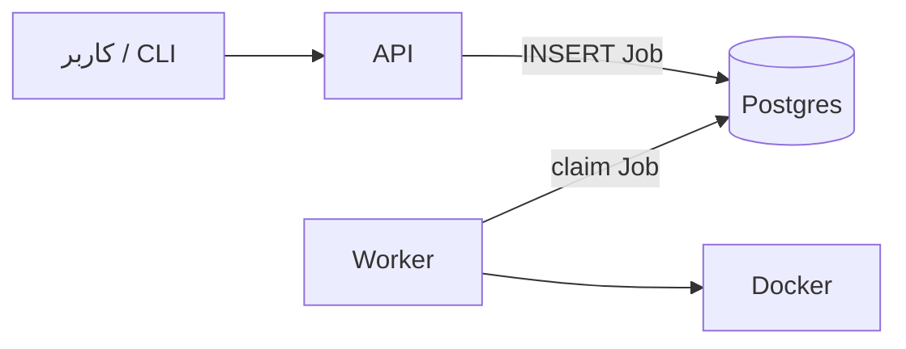

# فصل ۱ — نقشه‌ی معماری

[English](en/01-architecture.md) · **فارسی**

## هدف این فصل

بفهمید Dockra از چه بخش‌هایی ساخته شده، هر بخش چه مسئولیتی دارد و چرا مرزها دقیقاً همین‌جا کشیده شده‌اند.

## مسئله‌ای که حل می‌کنیم

یک PaaS باید سه کار متضاد را با هم انجام دهد:

1. درخواست کاربران را از اینترنت بگیرد (API عمومی).
2. روی سرور کارهای خطرناک انجام دهد: ساخت image، اجرای کانتینر، ساخت فایل‌سیستم.
3. کارهای طولانی (build چنددقیقه‌ای) را بدون معطل کردن درخواست‌ها انجام دهد.

اگر همهٔ این‌ها در یک پروسه باشد، یک باگ در پارس کردن JSON می‌تواند به `docker.sock` برسد؛ و دسترسی به `docker.sock` یعنی **root روی سرور**. راه‌حل Dockra: **پروسه‌ای که درخواست کاربر را می‌خواند، هیچ دسترسی‌ای به Docker ندارد.**

## یک کدبیس، چند نقش

```
api       Gunicorn + Django REST Framework    بدون docker.sock
worker    manage.py run_worker --queues ops    با docker.sock
builder   manage.py run_worker --queues build  با docker.sock
terminal  manage.py run_terminal               با docker.sock (asyncio + websockets)
web       Next.js                              فقط با API حرف می‌زند
traefik   مسیریابی، TLS، metric                 docker.sock فقط‌خواندنی
db        Postgres خود پلتفرم                   وضعیت + صف کار
```

هر چهار سرویس پایتونی **یک image** هستند (`dockra-api`) و فقط دستور اجرایشان فرق دارد. مزیت: یک کد، یک مجموعه مدل، یک بار تست. فایل `deploy/docker-compose.yml` را باز کنید و ببینید `volumes` کدام سرویس `docker.sock` دارد.

## جهت جریان



API فقط **نیت** را ثبت می‌کند: «کاربر X خواست اپ Y را مستقر کند». یک ردیف `Job` می‌سازد و برمی‌گردد. worker آن ردیف را برمی‌دارد و کار واقعی را انجام می‌دهد. این الگو اسم دارد: **command/queue separation**. پیامدهایش:

- API سریع جواب می‌دهد (`202 Accepted`) حتی اگر build ده دقیقه طول بکشد.
- اگر worker بمیرد، کار گم نمی‌شود؛ در جدول هست (فصل ۲).
- مجوز (authorization) فقط یک جا بررسی می‌شود: در API، قبل از ساخت Job. worker به Job اعتماد می‌کند چون فقط API می‌تواند آن را بسازد.

## کارهای فوری: صف `rpc`

بعضی کارها را کاربر **همین الان** جوابش را می‌خواهد: اجرای یک دستور در کنسول، خواندن لاگ کانتینر. این‌ها هم Docker لازم دارند. راه‌حل: صف سوم به اسم `rpc`. API یک Job در این صف می‌گذارد و با `run_rpc` (در `engine/runner.py`) چند ثانیه منتظر می‌ماند تا سرویس terminal نتیجه را در `Job.result` بنویسد. یعنی RPC روی دیتابیس! کند است (چند صد میلی‌ثانیه) ولی مرز امنیتی را نمی‌شکند.

## درایور: انتزاع روی Docker

`engine/drivers.py` دو کلاس دارد با یک رابط:

- `DockerDriver`: روی سرور، با `subprocess` و CLI داکر.
- `FakeDriver`: برای توسعه و تست؛ کارها را «وانمود» می‌کند.

با `DOCKRA_DRIVER=fake` و `DOCKRA_EAGER=1`، Jobها همان لحظه داخل درخواست اجرا می‌شوند. برای همین کل محصول روی لپ‌تاپ بدون Docker بالا می‌آید و ۱۷۹ تست در دو دقیقه اجرا می‌شوند. این همان **ports and adapters** است: منطق کسب‌وکار (runner) نمی‌داند پشت درایور Docker واقعی است یا نه.

چرا CLI داکر و نه SDK؟ چون هر دستوری که پلتفرم اجرا می‌کند، عیناً در لاگ دیده می‌شود و مدیر سرور می‌تواند همان را دستی تکرار کند. هزینه‌اش: باید خروجی متنی را پارس کرد.

## مسیر یک استقرار، از اول تا آخر

1. `dockra deploy` در `cli/dockra.py` → `POST /api/apps/shop/sync` با هش فایل‌ها.
2. `apps_core/extra.py::SyncPlan` → فهرست هش‌هایی که سرور ندارد.
3. CLI فقط همان‌ها را آپلود می‌کند → `POST /deploy`.
4. `apps_core/views.py::DeployView` → بررسی ظرفیت → `engine/actions.py::deploy_app` → `Deployment` + `Job(build)`.
5. builder: `runner.process_next_job` → `_claim` → `_deploy` → `DockerDriver.build_and_run`.
6. `_launch`: نسخهٔ جدید کنار قبلی، health check، حذف قبلی (فصل ۳).
7. CLI هر ۱.۵ ثانیه `GET /deployments` می‌زند تا وضعیت نهایی را نشان دهد.

## تمرین

1. در `deploy/docker-compose.yml` همهٔ سرویس‌هایی را که `/var/run/docker.sock` دارند پیدا کنید. اگر مهاجمی کنترل سرویس `web` را بگیرد، به چه چیزهایی دسترسی دارد؟ اگر `builder` را بگیرد چه؟
2. `run_rpc` را در `engine/runner.py` بخوانید. اگر سرویس terminal خاموش باشد، کاربر چه پیامی می‌بیند و بعد از چند ثانیه؟
3. یک متد جدید به `FakeDriver` و `DockerDriver` اضافه کنید که فقط `docker version` را برگرداند. تستش را فقط با `FakeDriver` بنویسید. چرا این تست روی هر ماشینی سبز است؟
