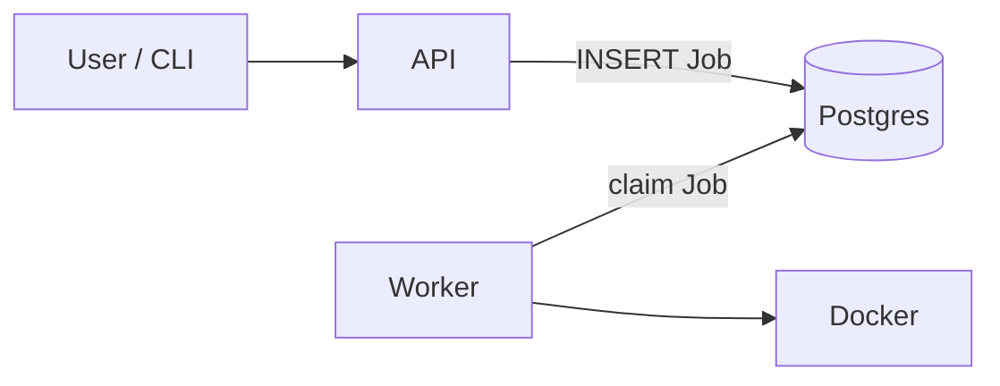

# Chapter 1 — The architecture map

**English** · [فارسی](../01-architecture.md)

## Goal of this chapter

Understand what Dockra is made of, what each part is responsible for, and why the boundaries are drawn exactly where they are.

## The problem we are solving

A PaaS has to do three conflicting things at once:

1. Accept user requests from the internet (a public API).
2. Do dangerous things on the server: build images, run containers, create filesystems.
3. Run long tasks (a build of several minutes) without holding requests hostage.

If all of this lives in one process, a bug in JSON parsing can reach `docker.sock`, and access to `docker.sock` means **root on the server**. Dockra's answer: **the process that reads user requests has no access to Docker at all.**

## One codebase, several roles

```
api       Gunicorn + Django REST Framework    no docker.sock
worker    manage.py run_worker --queues ops    with docker.sock
builder   manage.py run_worker --queues build  with docker.sock
terminal  manage.py run_terminal               with docker.sock (asyncio + websockets)
web       Next.js                              talks only to the API
traefik   routing, TLS, metrics                docker.sock read-only
db        the platform's own Postgres          state + job queue
```

All four Python services are **one image** (`dockra-api`); only their command differs. The benefit: one codebase, one set of models, tested once. Open `deploy/docker-compose.yml` and see which services have `docker.sock` in their `volumes`.

## Direction of flow



The API only records **intent**: "user X asked to deploy app Y". It creates a `Job` row and returns. A worker picks that row up and does the real work. This pattern has a name: **command/queue separation**. Its consequences:

- The API answers quickly (`202 Accepted`) even if the build takes ten minutes.
- If a worker dies, the work is not lost; it is in the table (chapter 2).
- Authorization is checked in exactly one place: in the API, before the Job is created. The worker trusts the Job because only the API can create one.

## Immediate work: the `rpc` queue

Some actions need an answer **right now**: running a command in the console, reading container logs. These need Docker too. The solution is a third queue called `rpc`. The API puts a Job in this queue and waits a few seconds with `run_rpc` (in `engine/runner.py`) for the terminal service to write the result into `Job.result`. RPC over the database, in other words. It is slow (a few hundred milliseconds) but it does not break the security boundary.

## The driver: an abstraction over Docker

`engine/drivers.py` has two classes with one interface:

- `DockerDriver`: on servers, through `subprocess` and the Docker CLI.
- `FakeDriver`: for development and tests; it "pretends" to do the work.

With `DOCKRA_DRIVER=fake` and `DOCKRA_EAGER=1`, jobs run immediately inside the request. That is why the whole product starts on a laptop without Docker and 182 tests run in two minutes. This is **ports and adapters**: the business logic (the runner) does not know whether a real Docker sits behind the driver.

Why the Docker CLI and not the SDK? Because every command the platform runs shows up verbatim in a log, and a server operator can repeat it by hand. The cost: text output has to be parsed.

## The path of one deployment, end to end

1. `dockra deploy` in `cli/dockra.py` → `POST /api/apps/shop/sync` with the file hashes.
2. `apps_core/extra.py::SyncPlan` → the list of hashes the server lacks.
3. The CLI uploads only those → `POST /deploy`.
4. `apps_core/views.py::DeployView` → capacity check → `engine/actions.py::deploy_app` → `Deployment` + `Job(build)`.
5. Builder: `runner.process_next_job` → `_claim` → `_deploy` → `DockerDriver.build_and_run`.
6. `_launch`: the new release next to the old one, health check, removal of the old one (chapter 3).
7. The CLI polls `GET /deployments` every 1.5 seconds to show the final status.

## Exercises

1. In `deploy/docker-compose.yml`, find every service that mounts `/var/run/docker.sock`. If an attacker took over the `web` service, what could they reach? What about `builder`?
2. Read `run_rpc` in `engine/runner.py`. If the terminal service is down, what message does the user see, and after how many seconds?
3. Add a new method to `FakeDriver` and `DockerDriver` that only returns `docker version`. Write its test against `FakeDriver` only. Why is that test green on any machine?
